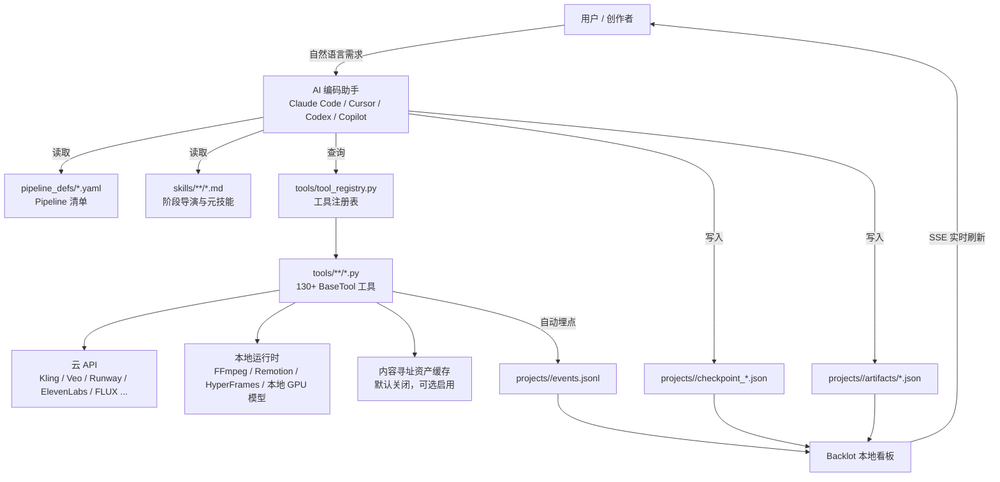
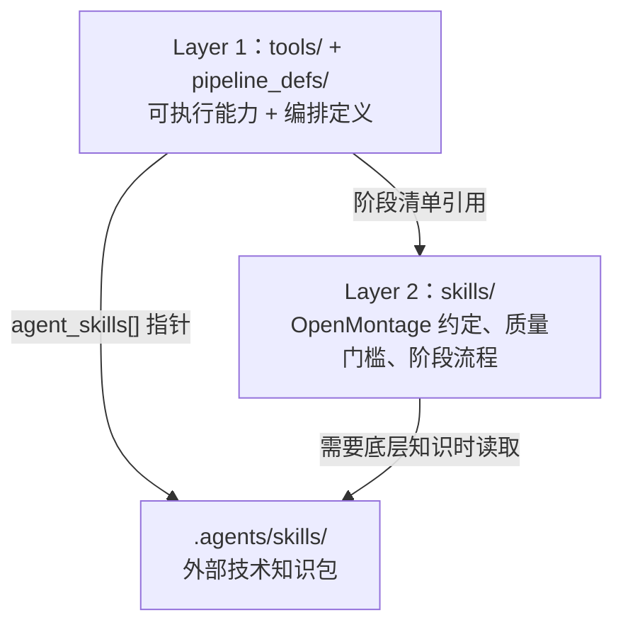
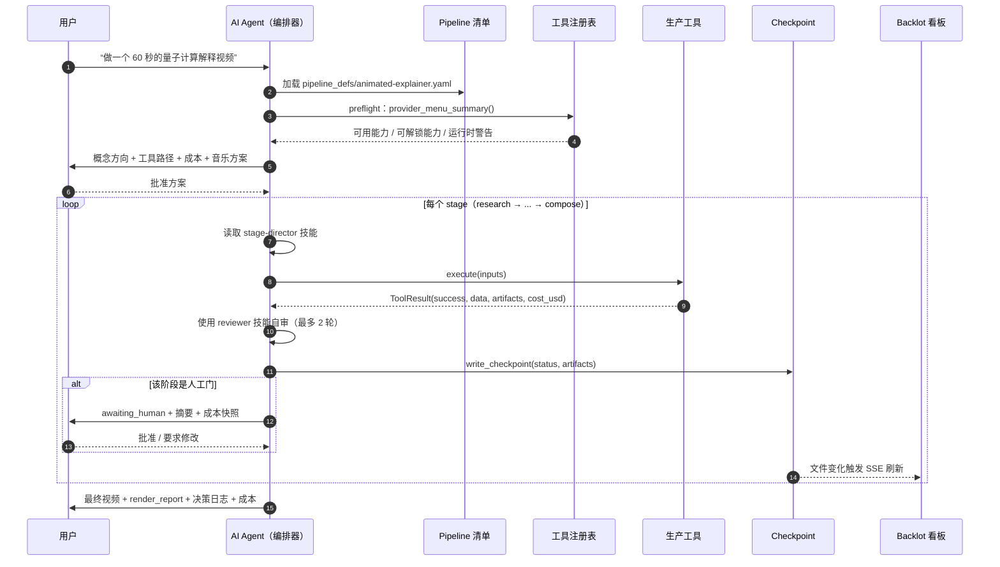
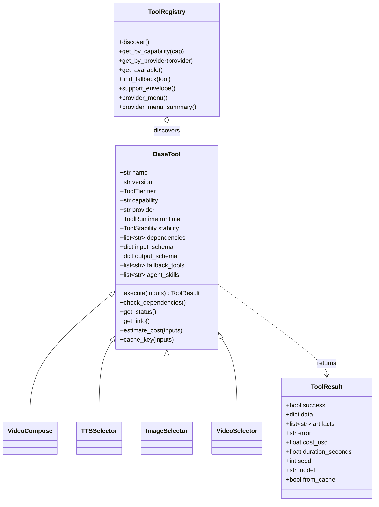
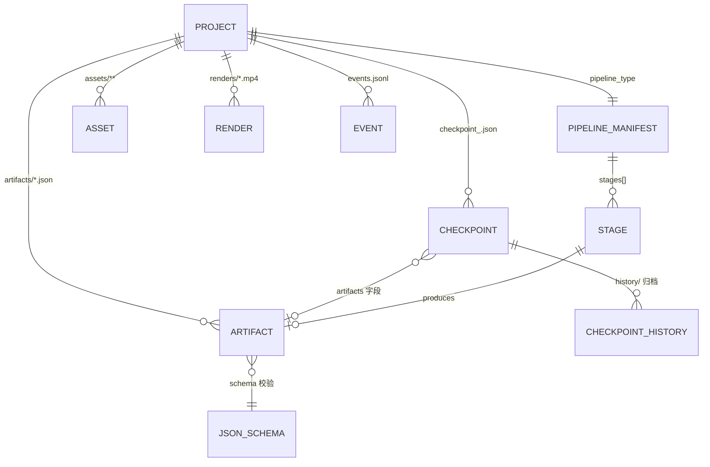
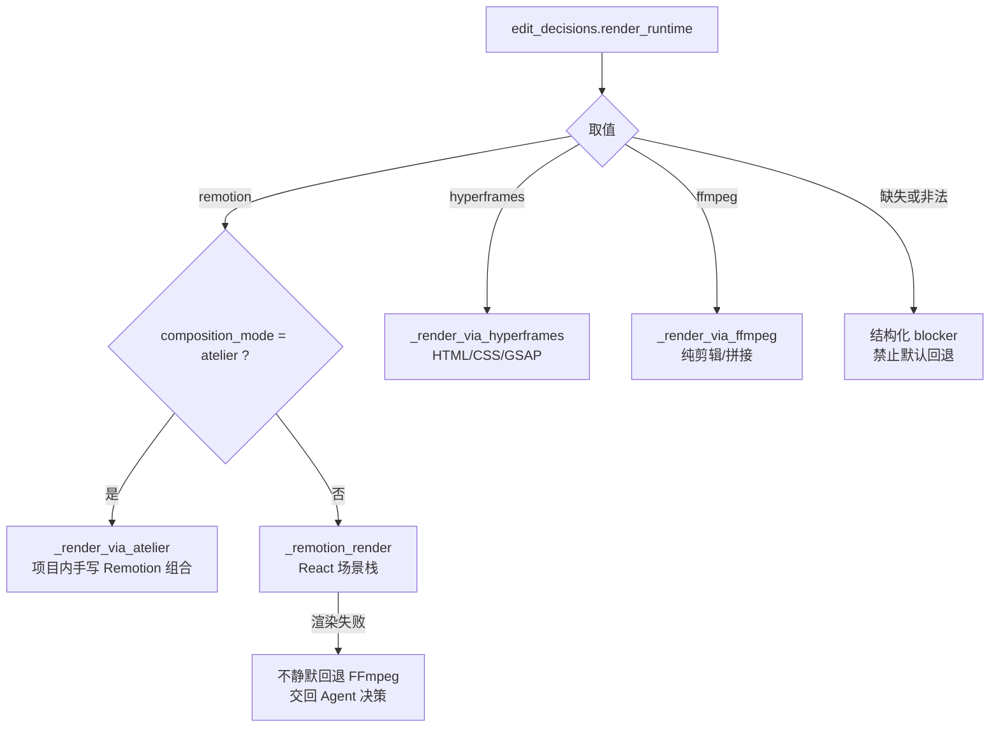
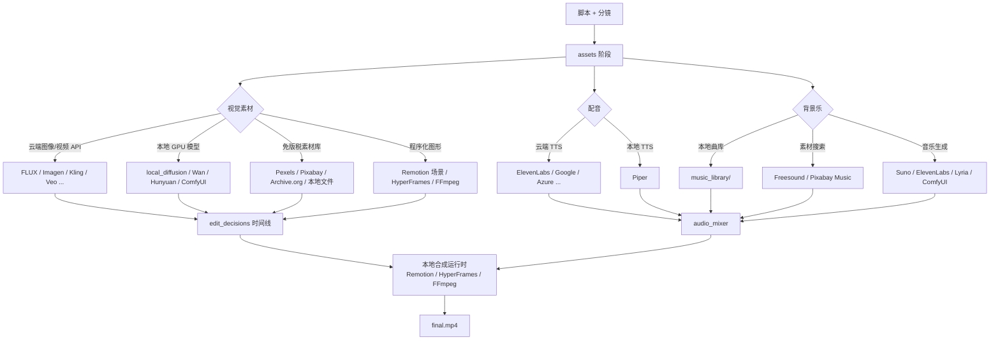
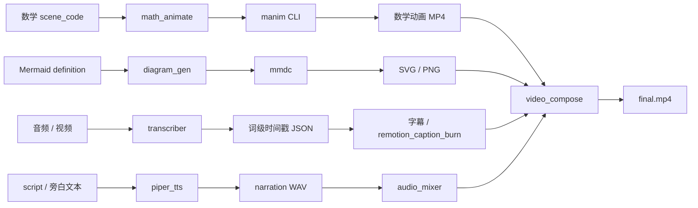
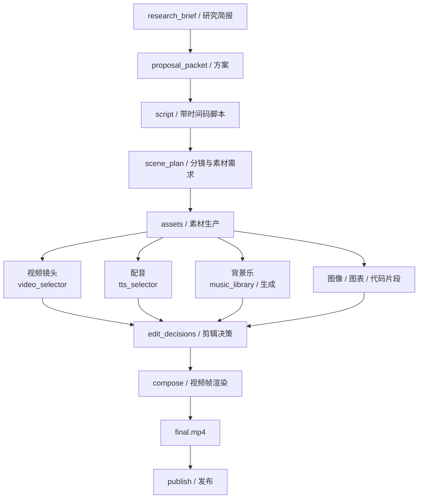

# OpenMontage 项目详细解析

> **文档元信息**
>
> | 项目 | 内容 |
> | --- | --- |
> | 生成时间 | 2026-11-05 03:51:47 |
> | 调用模型 | `deepseek-flash` |
> | IDE 工具 | Claude Code |
> | 仓库 | OpenMontage（`main` 分支，commit `d21f5d4`） |
> | 分析方式 | 基于仓库源码、Pipeline 清单、Schema、技能文档与测试目录的静态阅读 |
> | 文档目的 | 从“是什么、怎么跑、为什么这样设计”三个层面完整解释该项目 |

---

## 1. 项目定位

OpenMontage 是一个**开源、Agent 驱动的视频生产平台**。它不提供一个传统意义上的“视频生成 API”，而是把 AI 编码助手（Claude Code、Cursor、Codex、Copilot 等）变成一位**执行制片人**：Agent 读取 Pipeline 清单与阶段导演技能，调用 Python 工具完成调研、脚本、分镜、素材生成、剪辑和合成，并在每个关键创作节点上让人工审批。

它要解决的核心问题是：**把“从想法到成片”的完整视频生产流程，变成一套可检查、可恢复、可审计、可替换供应商的工程化流程**，而不是一次次依赖运气去写提示词、拼素材、手动剪辑。

一句话概括其设计哲学：

> **Agent 是智能，Python 只是工具与持久化。**

仓库中没有 Python 编排器、没有 Python 审稿器、没有 Python 状态机处理器。所有编排逻辑、创作判断、质量标准和检查点策略，都写在 Markdown 技能与 YAML Pipeline 清单里；Python 只负责“能做什么”（工具）和“记住做到哪了”（Checkpoint）。

---

## 2. 核心功能

### 2.1 端到端视频生产 Pipeline

内置 13 个 Pipeline 清单（`pipeline_defs/`），覆盖：

- AI 生成式解释视频（`animated-explainer`）
- 纯动画 / 动态图形（`animation`）
- 数字人 / 口播（`avatar-spokesperson`）
- 电影感预告片、氛围片（`cinematic`）
- 长视频批量切片（`clip-factory`）
- 真实素材纪录片式混剪（`documentary-montage`）
- 实拍 + AI 辅助混合（`hybrid`）
- 多语言字幕、配音、翻译（`localization-dub`）
- 播客再创作（`podcast-repurpose`）
- 软件录屏演示（`screen-demo`）
- 真人口播素材剪辑（`talking-head`）
- 本地绑定骨骼的卡通角色动画（`character-animation`）
- 框架冒烟测试（`framework-smoke`）

### 2.2 多供应商、可降级的能力层

- 仓库中通过 `grep "^class ...(BaseTool"` 统计到约 **132 个工具类声明**。
- README 宣称 **100+ 生产工具、60+ 供应商集成**。
- 覆盖视频生成、图像生成、TTS、音乐、音效、剪辑、增强、分析、字幕、数字人、3D 世界、角色动画、发布等能力族。
- 同时支持**云 API**（Kling、Veo、Runway、Seedance、ElevenLabs、FLUX、Imagen 等）与**本地/开源**路径（Piper、Wan、Hunyuan、CogVideo、LTX、WhisperX、Real-ESRGAN、Blender、Remotion、HyperFrames、FFmpeg）。

### 2.3 参考视频驱动创作

用户可以直接粘贴 YouTube、Shorts、Reel、TikTok 或本地视频作为参考。Agent 会分析转写文本、节奏、场景、关键帧和风格，输出：

- 参考视频“保留了什么”
- 新作品“改变了什么”
- 在当前工具条件下“实际会做成什么样”
- 目标时长下的成本估算
- 2–3 个有差异化的概念方向

对应技能：`skills/meta/video-reference-analyst.md`。

### 2.4 Backlot 实时看板

Backlot 是本地运行的“活分镜板”：

- Pipeline 阶段点亮、脚本以剧本页形式呈现、分镜以胶片条形式随素材生成逐步填充。
- 每个供应商决策、费用、事件都上墙。
- 素材阶段是一个真实的审批门：先看逐场景 contact sheet，再决定是否进入渲染。
- 支持对已完成运行进行时间轴回放（▶ REPLAY RUN）。

启动方式：

```bash
python -m backlot open <project-id>
python -m backlot open                  # 项目库视图
python -m backlot serve --port 4750     # 前台启动服务
```

### 2.5 生产治理

- **人工审批门**：由 Pipeline 清单的 `human_approval_default` 强制约束，Checkpoint 写入器会拒绝“未获批却写 completed”的越权操作。
- **Pre-compose 质量门**：交付承诺、幻灯片风险、渲染器家族缺失都会阻止渲染。
- **Post-render 自审**：ffprobe、抽帧、音频电平、交付承诺、字幕检查。
- **决策审计日志**：供应商、风格、音乐、声音、运行时、降级路径全部记录。
- **预算治理**：预估 → 预留 → 对账，支持 `observe` / `warn` / `cap` 三种模式。

### 2.6 三层知识架构

- **Layer 1**：`tools/` + `pipeline_defs/` —— 有什么工具、什么时候用。
- **Layer 2**：`skills/` —— OpenMontage 希望你怎么用这些工具。
- **Layer 3**：`.agents/skills/` —— 底层技术/供应商知识（Remotion、GSAP、HyperFrames、Kling、ElevenLabs、FFmpeg 等）。

每个工具的 `agent_skills[]` 字段负责把 Layer 1 指向 Layer 2/3。

---

## 3. 项目架构

### 3.1 整体架构图



这张图的关键点：**Agent 位于中心**。它既读指令层（YAML + Markdown），也调用工具层（Python），但不把编排逻辑沉到 Python 里。Backlot 只是观察者，从磁盘状态派生看板，永远不是阻塞器。

### 3.2 三层知识架构



阅读顺序也是这个顺序：

1. 先看 Registry / Tool Contract，知道机器上到底有什么可用。
2. 再看 Pipeline 或创作类技能，知道在当前语境下“怎么用”。
3. 调用任何生成工具前，必须读它的 Layer 3 技能，拿到供应商特有的提示词结构、参数建议和质量技巧。

### 3.3 一次视频生产的主流程



### 3.4 数据模型

#### 3.4.1 工具契约



`BaseTool` 的契约字段非常关键，它决定了工具能否被正确发现、评分、降级和审计。核心字段包括：

| 字段 | 作用 |
| --- | --- |
| `name` / `version` | 工具身份与缓存键的一部分 |
| `tier` | CORE / VOICE / ENHANCE / GENERATE / SOURCE / ANALYZE / PUBLISH |
| `capability` | 能力族，如 `tts`、`image_generation`、`video_post` |
| `provider` | 供应商/运行时，如 `elevenlabs`、`ffmpeg`、`selector` |
| `runtime` | `local` / `local_gpu` / `api` / `hybrid` |
| `stability` | `experimental` / `beta` / `production` |
| `dependencies` | `cmd:`、`binary:`、`env:`、`python:` 四类依赖 |
| `fallback_tools` | 有序降级链 |
| `agent_skills` | 指向 Layer 3 技能 |
| `resource_profile` | CPU / RAM / VRAM / 磁盘 / 网络 |
| `retry_policy` | 重试次数、退避、可重试错误 |
| `idempotency_key_fields` | 内容寻址缓存与幂等键 |
| `determinism` | deterministic / seeded / stochastic |

#### 3.4.2 项目工作区与产物关系



一个生产项目的标准目录：

```text
projects/<project-id>/
├── project.json              # 看板识别项目的标记文件
├── artifacts/                # 各阶段 JSON 产物
├── assets/
│   ├── images/
│   ├── video/
│   ├── audio/
│   ├── music/
│   └── subtitles.srt
├── renders/
│   └── final.mp4             # 最终交付物
├── checkpoint_<stage>.json   # 每个阶段的状态
├── history/                  # 被覆盖 Checkpoint 的归档
└── events.jsonl              # 工具执行事件（Backlot 实时数据源）
```

### 3.5 目录结构

```text
OpenMontage/
├── AGENT_GUIDE.md              # Agent 的完整操作契约（最重要入口）
├── PROJECT_CONTEXT.md          # 架构与约定的共享上下文
├── CLAUDE.md / CURSOR.md / CODEX.md / COPILOT.md
├── config.yaml                 # 全局运行配置
├── Makefile                    # setup / test / demo / preflight 等入口
├── pipeline_defs/              # 13 个 Pipeline YAML 清单
├── skills/
│   ├── pipelines/              # 12 套阶段导演技能（103 个 Markdown）
│   ├── core/                   # FFmpeg / Remotion / HyperFrames 等核心工具技能
│   ├── creative/               # 36 个创作技法技能
│   └── meta/                   # reviewer、checkpoint、onboarding、taste 等元技能
├── .agents/skills/             # Layer 3 外部技术知识（约 580 个 Markdown）
├── tools/                      # 132 个 BaseTool 子类声明
│   ├── video/                  # 视频生成、合成、拼接、剪辑
│   ├── audio/                  # TTS、音乐、混音、音频增强
│   ├── graphics/               # 图像生成、图表、代码截图、3D 世界
│   ├── analysis/               # 转写、场景检测、抽帧、视频理解
│   ├── avatar/                 # 数字人、口型同步
│   ├── enhancement/            # 超分、去背景、人脸修复、调色
│   ├── character/              # 角色规格、骨骼、姿态、动作时间线、QA
│   ├── capture/                # 屏幕录制
│   ├── subtitle/               # 字幕生成
│   ├── publishers/             # 发布
│   └── _comfyui/ _kling/       # 内部适配辅助（非独立工具）
├── lib/                        # 配置、Checkpoint、Pipeline 加载、评分、质量门
├── schemas/                    # 20 个产物 Schema + Checkpoint/Pipeline/Style/Tool Schema
├── styles/                     # 5 个视觉风格 Playbook（YAML）
├── remotion-composer/          # React/Remotion 合成引擎（TypeScript）
├── backlot/                    # FastAPI + SSE 本地看板
├── ink-theater/                # 手绘水墨风格动画引擎与动作捕捉
├── tests/                      # 143 个测试文件
├── scripts/                    # 冒烟、模拟运行、截图、脚手架等脚本
└── docs/                       # 架构、供应商、工作流文档
```

---

## 4. 核心技术栈

| 层面 | 技术 |
| --- | --- |
| 编排层 | LLM 编码助手（Claude Code / Cursor / Copilot / Codex / Windsurf） |
| 指令层 | YAML Pipeline 清单 + Markdown 技能（约 736 个技能文件） |
| 运行时 | Python 3.10+ |
| 数据校验 | JSON Schema（`jsonschema`） |
| 配置模型 | Pydantic v2 |
| 本地看板 | FastAPI + Uvicorn + watchfiles + SSE |
| 视频合成 | FFmpeg、Remotion 4（React 18 + TypeScript 5）、HyperFrames（HTML/CSS/GSAP） |
| 视觉风格 | YAML Playbook + `styles/playbook_loader.py` |
| 测试 | pytest + pytest-asyncio + httpx |
| 3D / 角色 | Three.js、Blender 4.5 LTS、SVG 骨骼、GSAP 时间线 |
| 本地 AI | WhisperX、Piper、Wan、Hunyuan、CogVideo、LTX、Real-ESRGAN、rembg、CodeFormer/GFPGAN |

外部命令依赖：

- **必需**：Python 3.10+、FFmpeg（约 15 个工具依赖）。
- **可选**：Node.js 18+（Remotion）、Node.js 22+（HyperFrames）、CUDA GPU（本地生成模型）、Piper（离线 TTS）、ManimCE、Mermaid CLI。

---

## 5. 核心原理

### 5.1 Agent-First：没有 Python 编排器

传统工作流引擎会把状态机、分支、重试、审核写进代码。OpenMontage 反其道而行之：

```python
# 伪代码：Agent 的主循环（实际由 LLM 按技能执行，不是 Python 代码）
def run_pipeline(user_request):
    manifest = load_yaml(f"pipeline_defs/{select_pipeline(user_request)}.yaml")
    capability_menu = registry.provider_menu_summary()
    present_to_user(capability_menu, manifest)

    stage = checkpoint.get_next_stage(project_id) or manifest.stages[0]

    while stage is not None:
        skill = read_markdown(stage.skill)          # 先读“怎么做”
        artifact = execute_stage(stage, skill)      # 再调用工具
        review = self_review(artifact, stage.review_focus, max_rounds=2)

        if review.has_critical and review.round < 2:
            artifact = revise(artifact, review)
            continue

        checkpoint.write(stage, artifact, review, cost_snapshot)

        if stage.human_approval_default:
            present_for_approval(artifact)
            wait_for_human()                        # 本轮必须结束
            checkpoint.mark_approved(stage)

        stage = checkpoint.get_next_stage(project_id)

    return render_report
```

为什么这样做？

- **可调试**：行为不对时，直接读技能文件，而不是在 Python 里追调用栈。
- **模型无关**：任何能读文件、能执行 Python 的 Agent 都能驱动同一套 Pipeline。
- **可修改**：调整质量标准、提示策略、审批策略，只需改 Markdown/YAML，不需要改代码。
- **职责清晰**：Python 负责确定性工作（调用 API、编码、校验、持久化），LLM 负责判断性工作（选题、脚本、构图、取舍）。

### 5.2 工具系统：自动发现、依赖感知、可观测、可缓存

#### 5.2.1 自动发现

`ToolRegistry.discover()` 使用 `pkgutil.walk_packages()` 遍历 `tools` 包，导入每个模块，再用 `inspect` 找出**定义在该模块内**的具体 `BaseTool` 子类并实例化。没有手动注册表，也没有中心化 import 列表。

```python
# 伪代码：注册表发现流程
def discover(package="tools"):
    load_dotenv()
    for module_info in walk_packages(package.__path__):
        module = import_module(module_info.name)
        for cls in inspect.getmembers(module, inspect.isclass):
            if issubclass(cls, BaseTool) and cls.__module__ == module.__name__:
                register(cls())      # 只要继承 BaseTool 就会被发现
```

#### 5.2.2 依赖与状态

工具通过声明式依赖表达“是否可用”：

- `cmd:ffmpeg` / `binary:ffprobe`：命令是否存在。
- `env:ELEVENLABS_API_KEY`：环境变量是否设置。
- `python:torch`：Python 模块是否可导入。

`get_status()` 返回 `available` / `unavailable` / `degraded`。预检时，Agent 用 `provider_menu_summary()` 得到“X / Y 已配置”的能力菜单，而不是把几 MB 的原始 `support_envelope()` 倒进聊天窗口。

#### 5.2.3 自动埋点

`BaseTool.__init_subclass__` 在类定义时自动包装子类的 `execute()`：

```python
# 伪代码：装饰顺序
cls.execute = cache_wrap(instrument_wrap(original_execute))
```

- `instrument_wrap` 在 `execute()` 前后向项目目录的 `events.jsonl` 写入 `start` / `finish` / `error` 事件，供 Backlot 显示“正在生成”的微光状态与活动流水。
- 埋点失败完全不影响工具执行。
- 选择器调用供应商工具时会形成嵌套事件，通过 `depth` 字段去重成本统计。

#### 5.2.4 内容寻址缓存

缓存默认关闭，只有设置 `OPENMONTAGE_ASSET_CACHE` 才启用。启用后：

- 只缓存**可复现、单产物、写文件**的调用。
- `deterministic` 工具总是可缓存；`seeded` 工具必须显式给 `seed`；`stochastic` 工具从不缓存。
- 缓存键包含工具名、版本、输出后缀，以及声明的幂等输入字段。
- 输入若是文件路径，会按**文件内容 SHA-256** 计算，避免“路径相同但内容已变”导致命中过期结果。
- 命中时直接返回 `cost_usd=0`、`from_cache=True` 的 `ToolResult`。

```python
# 伪代码：缓存键
def cache_key(inputs):
    payload = {
        "tool": self.name,
        "version": self.version,
        "output_suffix": suffix(inputs["output_path"]),
        "fields": {k: content_hash_if_file(inputs.get(k))
                   for k in self.idempotency_key_fields},
    }
    return sha256(json.dumps(payload, sort_keys=True)).hexdigest()
```

### 5.3 选择器与七维打分

`tts_selector`、`image_selector`、`video_selector` 是三个“能力路由工具”。它们不硬编码供应商顺序，而是从注册表实时发现所有具备对应 `capability` 的工具，再打分排序。

七个维度的权重（`lib/scoring.py`）：

| 维度 | 权重 | 含义 |
| --- | ---: | --- |
| `task_fit` | 30% | 该工具是否最适合当前资产类型与创作意图 |
| `output_quality` | 20% | 对当前 brief 的预期保真度 |
| `control` | 15% | 参考图、风格、参数可控性 |
| `reliability` | 15% | 运行时稳定性 |
| `cost_efficiency` | 10% | 每美元产出质量 |
| `latency` | 5% | 交付速度 |
| `continuity` | 5% | 与已锁定决策的一致性 |

```python
# 伪代码：选择器路由
def select_provider(capability, user_preference, task_context):
    candidates = registry.get_by_capability(capability)
    candidates = [c for c in candidates if c.get_status() == "available"]

    if user_preference and user_preference in candidates:
        return user_preference

    scored = []
    for tool in candidates:
        score = ProviderScore(
            tool_name=tool.name,
            provider=tool.provider,
            task_fit=compute_task_fit(tool.best_for, task_context),
            output_quality=quality_heuristic(tool),
            control=control_heuristic(tool),
            reliability=reliability(tool),
            cost_efficiency=cost_score(tool, task_context),
            latency=latency_score(tool),
            continuity=continuity_score(tool, task_context),
        )
        scored.append(score)

    best = max(scored, key=lambda s: s.weighted_score)
    log_decision(category="provider_selection", options=scored, selected=best)
    return best.tool_name
```

打分不只用于单个工具，也用于**整条生产路径**（`ProductionPathScore`），八个维度分别是：交付契合度、质量契合度、能力置信度、降级链完整性、预算契合度、速度、可控性、一致性。

选择器输出还会带上被选工具的 `agent_skills`，Agent 可以立刻去读对应的 Layer 3 技能，再写提示词。

### 5.4 Pipeline 状态机

Pipeline 是声明式 YAML。一个典型的阶段定义包含：

- `skill`：阶段导演技能路径。
- `required_artifacts_in` / `optional_artifacts_in`：进入该阶段需要哪些上游产物。
- `produces`：该阶段产出的规范产物。
- `tools_available` / `required_tools` / `optional_tools`：可用工具。
- `checkpoint_required`：是否必须写检查点。
- `human_approval_default`：是否必须人工批准。
- `review_focus`：审稿关注点。
- `success_criteria`：成功标准。

标准阶段流：

```text
research → proposal → script → scene_plan → assets → edit → compose → publish
```

但不是每个 Pipeline 都一样：

- `documentary-montage`：`idea → scene_plan → assets → edit → compose`（没有传统脚本阶段）。
- `character-animation`：在 `script` 与 `scene_plan` 之间插入 `character_design`、`rig_plan`。
- `framework-smoke`：只有 `research → script`，用于框架冒烟。


### 5.5 Checkpoint 与审批门：把“流程”变成“可恢复状态”

Checkpoint 是 Pipeline 的存档点，位于：

```text
projects/<project_id>/checkpoint_<stage>.json
```

状态值：

- `in_progress`
- `awaiting_human`
- `completed`
- `failed`

核心规则：

1. **状态为 `completed` / `awaiting_human` 时，必须包含该阶段的规范产物**。
2. **规范产物必须通过 JSON Schema 校验**。
3. **人工门阶段不能绕过**：如果清单里 `human_approval_default: true`，写入 `completed` 时必须带 `human_approved=True`，否则抛出 `GATE VIOLATION`。
4. **历史归档**：被覆盖的 `completed` / `awaiting_human` 检查点会复制到 `history/`，阶段重跑不会摧毁审计轨迹。
5. **断点恢复**：`get_next_stage()` 读取所有检查点，返回下一个需要执行的阶段；`in_progress` 检查点可携带 `metadata.partial_progress` 支持场景级续跑。

```python
# 伪代码：门禁写入
def write_checkpoint(stage, status, artifacts, human_approved=False):
    validate_artifacts(stage, status, artifacts)
    validate_against_schema(artifacts)

    if stage.human_approval_default and status == "completed":
        if not human_approved:
            raise GateViolation(
                "本阶段必须人工批准后才能写 completed；"
                "正确做法是先写 awaiting_human，获批后再重写。"
            )

    archive_previous_checkpoint_to_history()
    write_json(checkpoint_path(stage), {...})
```

审批门不是“建议”，而是**由清单值强制绑定**。Agent 不能因为“这次情况特殊”就跳过；如果用户提前授权整轮运行，必须把该授权记录为 `decision_log` 中 `category: "approval_policy"` 的条目，否则每个门都必须停。

### 5.6 产物契约：20 个 JSON Schema

`schemas/artifacts/` 下定义了 20 个规范产物：

- 研究/提案：`research_brief`、`proposal_packet`、`brief`
- 脚本/分镜：`script`、`scene_plan`、`action_timeline`
- 角色动画：`character_design`、`rig_plan`、`pose_library`、`character_qa_report`
- 素材/剪辑/渲染：`asset_manifest`、`edit_decisions`、`render_report`
- 发布/审核：`publish_log`、`review`、`final_review`
- 治理：`decision_log`、`cost_log`
- 输入分析：`source_media_review`、`video_analysis_brief`

阶段与规范产物的映射（`lib/checkpoint.py`）：

| 阶段 | 规范产物 |
| --- | --- |
| `research` | `research_brief` |
| `proposal` | `proposal_packet` |
| `idea` | `brief` |
| `script` | `script` |
| `scene_plan` | `scene_plan` |
| `assets` | `asset_manifest` |
| `edit` | `edit_decisions` |
| `compose` | `render_report` |
| `publish` | `publish_log` |

此外还有三类“补充产物”，它们不是阶段定义产物，但被治理契约要求：

- `source_media_review`：用户提供自有素材时，在首次规划前必须完成。
- `final_review`：compose 阶段在呈现给用户前必须完成。
- `video_analysis_brief`：参考视频驱动时随阶段携带。

### 5.7 合成运行时路由：Remotion / HyperFrames / FFmpeg

`video_compose` 是面向 Pipeline 的合成总入口。它不默认选引擎，而是读取**在提案阶段锁定**的 `edit_decisions.render_runtime`：



关键治理规则：

- `render_runtime` 缺失时直接失败，要求回提案阶段补上明确选择，**不允许工具自己猜**。
- Remotion 失败时，工具**不会**自动切 FFmpeg；它返回结构化 blocker，由 Agent 按“显式升级阻塞”协议询问用户。
- HyperFrames 锁定但运行时不可用（Node < 22、缺 FFmpeg/npx、`hyperframes doctor` 报错）同样视为 blocker。
- 运动承诺为硬要求的 brief（科幻预告、氛围片、数字人口播等）禁止悄悄降级成“静态图 + Ken Burns”的 animatic。

**模板化 vs 工作室模式（atelier）**：

- **Templated**：复用 `text_card`、`stat_card`、`bar_chart` 等库存场景组件，快、便宜、稳定，但容易“千片一面”。
- **Atelier**：从零手写组合、专属主题、专属运动语言，通过 `composition_mode: "atelier"` 进入 `_render_via_atelier` 或 HyperFrames 的本地 authoring workspace。适合营销、发布、品牌、英雄级单交付物。

Remotion 场景类型包括：

`text_card`、`hero_title`、`stat_card`、`callout`、`comparison`、`bar_chart`、`line_chart`、`pie_chart`、`kpi_grid`、`progress_bar`、`anime_scene`、`terminal_scene`、`screenshot_scene`，以及覆盖层 `section_title`、`stat_reveal`、`hero_title`、`provider_chip`。

### 5.8 质量门：从“看起来像视频”到“真的能交付”

#### 5.8.1 预检（Preflight）

Agent 必须先运行：

```bash
python -c "
from tools.tool_registry import registry
import json
registry.discover()
print(json.dumps(registry.provider_menu_summary(), indent=2))
"
```

输出四个关键字段：

- `composition_runtimes`：FFmpeg / Remotion / HyperFrames 是否可用。
- `capabilities[]`：每个能力族的 `configured / total` 与供应商列表。
- `setup_offers[]`：一分钟环境变量修复即可解锁的工具。
- `runtime_warnings[]`：如 “hyperframes: npm package not resolvable” 这类“看起来可用其实不可用”的警告。

#### 5.8.2 交付承诺（Delivery Promise）

`lib/delivery_promise.py` 在提案阶段对“这部片到底承诺交付什么”分类，并在 compose 前验证：

| 承诺类型 | 允许静态图降级 | 最低运动比例 |
| --- | --- | ---: |
| `motion_led` | 否 | 70% |
| `source_led` | 是 | 30% |
| `data_explainer` | 是 | 0% |
| `teacher_explainer` | 是 | 0% |
| `screen_demo` | 是 | 0% |
| `avatar_presenter` | 否 | 30% |
| `hybrid` | 是 | 20% |
| `localization` | 是 | 0% |

如果 brief 承诺“运动主导”，而剪辑里 80% 都是静态图，`video_compose` 会在渲染前直接阻断。

#### 5.8.3 幻灯片风险评分

`lib/slideshow_risk.py` 从 6 个维度打分（0–5，越低越好）：

1. 重复性（repetition）
2. 装饰性视觉（decorative visuals）
3. 弱运动（weak motion）
4. 弱镜头意图（weak shot intent）
5. 文字过度依赖（typography overreliance）
6. 无依据的电影感声明（unsupported cinematic claims）

判定：

- `< 2.0`：strong
- `< 3.0`：acceptable
- `< 4.0`：revise（警告）
- `>= 4.0`：fail（阻止进入 compose）

#### 5.8.4 Pre-compose 校验

`video_compose._pre_compose_validation()` 在真正渲染前检查：

1. 交付承诺是否被违反。
2. 幻灯片风险是否为 `fail`。
3. `renderer_family` 是否缺失（缺失直接阻断，因为它必须提案阶段锁定）。

#### 5.8.5 Post-render 自审

渲染完成后运行 `final_review`：

- ffprobe 校验容器、编码、分辨率、时长。
- 在 4 个位置抽帧，检查黑帧、破损覆盖层。
- 分析音频电平，检查静音与削波。
- 验证交付承诺是否兑现。
- 检查字幕是否存在。
- 检测 `render_runtime` 是否在提案与合成之间被偷换。

如果自审失败，成品不会被呈现给用户。

### 5.9 成本治理

`tools/cost_tracker.py` 用三段式生命周期管理花费：

```text
estimate(tool, operation, $) → entry_id
        ↓
reserve(entry_id)            # 锁定预算
        ↓
reconcile(entry_id, $)       # 记录实际花费
```

三种预算模式：

| 模式 | 行为 |
| --- | --- |
| `observe` | 只记录，不拦截 |
| `warn` | 超支只警告，仍允许执行 |
| `cap` | 超过剩余预算直接拒绝 |

默认配置（`config.yaml`）：

- 总预算：`$10.00`
- 预留比例：`10%`
- 单次操作审批阈值：`$0.50`
- 首次使用付费工具需要批准

### 5.10 Backlot：从磁盘派生状态，而不是让 Agent 汇报

Backlot 的架构非常简单但有效：

- 一个 `watchfiles` 监听 `projects/` 目录。
- 文件变化通过 SSE 推送给浏览器。
- 浏览器重新拉取看板状态。
- 所有状态都从已有文件派生：

| 看板元素 | 磁盘来源 |
| --- | --- |
| 项目身份 / 阶段轨道 | `project.json` + `pipeline_defs/<type>.yaml` |
| 阶段状态 / 审批门 / 版本 | `checkpoint_<stage>.json` + `history/` |
| 脚本卡片 | `artifacts/script.json` |
| 胶片条卡片 | `scene_plan × script × asset_manifest` 联表 |
| 生成中微光 / 活动流水 | `events.jsonl`（`BaseTool` 自动埋点写入） |
| 成本仪表 | Checkpoint 的 `cost_snapshot` |
| 成片 | `renders/*.mp4` |

安全方面：Backlot 只绑定 `127.0.0.1`，并校验 `Host` 头，拒绝非 `127.0.0.1` / `localhost` 的请求，防止 DNS rebinding。

Backlot 的哲学是：**看板是观察者，永远不是阻塞器**。即使看板启动失败，生产也继续。

### 5.11 参考视频驱动

当用户提供参考视频时，Agent 不应退化成“网页搜索 + 猜提示词”，而要走专门的分析工作流：

1. 下载 / 转写 / 场景检测 / 抽帧。
2. 生成 `video_analysis_brief`：内容、节奏、结构、风格、有效原因。
3. 基于分析结果产出 2–3 个**差异化**概念，而不是复制。
4. 每个阶段都要做“参考对齐审查”：
   - **Grounding**：输出是否引用了分析简报中的具体发现？
   - **Differentiation**：每个概念是否至少有明确元素不同于参考？

如果提案声称参考视频“节奏快”，而分析简报写的是“缓慢沉思”，这是 CRITICAL 级问题。

### 5.12 一套典型的“工具调用 + 审查 + 检查点”伪代码

```python
# 伪代码：assets 阶段（简化）
def run_assets_stage(project, manifest, scene_plan):
    write_checkpoint(project, "assets", status="in_progress", artifacts={})

    asset_manifest = {"version": "1.0", "assets": []}

    for scene in scene_plan["scenes"]:
        for requirement in scene["required_assets"]:
            tool = select_tool(requirement, manifest.tools_available)
            announce(tool, provider, model, reason, sample_or_batch)

            result = tool.execute({
                "output_path": f"projects/{project}/assets/{requirement.kind}/...",
                "prompt": build_prompt(requirement, scene, playbook),
                "scene_id": scene["id"],
            })

            if not result.success:
                escalate_blocker(tool, result.error)
                return

            asset_manifest["assets"].append({
                "id": result.data["asset_id"],
                "path": result.artifacts[0],
                "scene_id": scene["id"],
                "tool": tool.name,
                "provider": tool.provider,
                "cost_usd": result.cost_usd,
                "seed": result.seed,
                "model": result.model,
            })

            # 场景级进度刷新，看板实时可见
            write_checkpoint(
                project, "assets",
                status="in_progress",
                artifacts={},
                metadata={"partial_progress": {
                    "asset_manifest_draft": asset_manifest,
                    "completed_scene_ids": [...],
                }},
            )

    review = self_review(asset_manifest, manifest.stage("assets").review_focus)
    if review.has_critical:
        fix_and_recheck(max_rounds=2)

    write_checkpoint(
        project, "assets",
        status="awaiting_human",   # assets 在多数 Pipeline 中是人工门
        artifacts={"asset_manifest": asset_manifest},
        metadata={"review": review.to_dict(), "cost_snapshot": cost_tracker.snapshot()},
    )
    return "WAIT_FOR_HUMAN"
```

---

## 6. Pipeline 清单与阶段门

以下数据直接来自 `pipeline_defs/*.yaml`：

| Pipeline | 类别 | 稳定性 | 阶段顺序 | 人工门 |
| --- | --- | --- | --- | --- |
| `animated-explainer` | generated | production | research → proposal → script → scene_plan → assets → edit → compose → publish | proposal, script, scene_plan, assets, publish |
| `animation` | animation | production | research → proposal → script → scene_plan → assets → edit → compose → publish | proposal, script, scene_plan, assets, publish |
| `avatar-spokesperson` | custom | production | idea → script → scene_plan → assets → edit → compose → publish | idea, script, scene_plan, assets, publish |
| `character-animation` | animation | beta | research → proposal → script → character_design → rig_plan → scene_plan → assets → edit → compose → publish | proposal, script, character_design, scene_plan, assets, publish |
| `cinematic` | cinematic | production | research → proposal → script → scene_plan → assets → edit → compose → publish | proposal, script, scene_plan, assets, publish |
| `clip-factory` | custom | beta | idea → script → scene_plan → assets → edit → compose → publish | idea, script, scene_plan, assets, publish |
| `documentary-montage` | documentary | beta | idea → scene_plan → assets → edit → compose | idea, scene_plan, assets, edit |
| `framework-smoke` | custom | beta | research → script | research, script |
| `hybrid` | hybrid | production | idea → script → scene_plan → assets → edit → compose → publish | idea, script, scene_plan, assets, publish |
| `localization-dub` | custom | beta | idea → script → scene_plan → assets → edit → compose → publish | idea, script, scene_plan, assets, publish |
| `podcast-repurpose` | custom | beta | idea → script → scene_plan → assets → edit → compose → publish | idea, script, scene_plan, assets, publish |
| `screen-demo` | screen_recording | production | idea → script → scene_plan → assets → edit → compose → publish | idea, script, scene_plan, assets, publish |
| `talking-head` | talking_head | beta | idea → script → scene_plan → assets → edit → compose → publish | idea, script, scene_plan, assets, publish |

> **注意**：`AGENT_GUIDE.md` 的 Pipeline 表格没有列出 `documentary-montage`，而 README 列出了它却没有列 `character-animation` / `framework-smoke`。以 `pipeline_defs/` 与 `lib/pipeline_loader.list_pipelines()` 为准。

---

## 7. 工具能力地图

按工具类中 `capability = "..."` 声明粗略统计（grep 口径，包含选择器与内部实现，不完全等于“可用供应商数”）：

| 能力族 | 工具类声明数 | 典型工具 |
| --- | ---: | --- |
| `video_generation` | 34 | Kling、Veo、Runway、Seedance、MiniMax、Wan、Hunyuan、CogVideo、LTX、Grok、HeyGen、Pexels/Pixabay |
| `image_generation` | 30 | FLUX、Imagen、GPT Image、Seedream、Recraft、Ideogram、Qwen、Local Diffusion、Pexels/Unsplash/Pixabay |
| `tts` | 15 | ElevenLabs、Google、OpenAI、Piper、Azure、Kling、DashScope、Doubao、Fish Audio、Cartesia、Inworld、Mistral |
| `analysis` | 14 | WhisperX 转写、Azure STT、场景检测、抽帧、视频理解、Composition Validator |
| `video_post` | 10 | `video_compose`、`video_stitch`、`video_trimmer`、自动重构图、绿幕合成、字幕烧录 |
| `music_generation` | 6 | Suno、ElevenLabs Music、Google Music、fal ElevenLabs Music、ComfyUI Music |
| `enhancement` | 6 | 超分、去背景、人脸增强、人脸修复、调色 |
| `character_animation` | 6 | 角色规格、骨骼计划、姿态库、动作时间线、HyperFrames 包、QA |
| `avatar` | 5 | Talking Head、Lip Sync、Kling Avatar、Kling Lip Sync |
| `screen_capture` | 3 | 屏幕录制、Playwright 录制等 |
| `graphics` | 3 | 图表生成、代码截图、数学动画 |
| `subtitle` | 2 | SRT/VTT 生成 |
| `music_search` | 2 | 免版税音乐搜索 |
| `audio_processing` | 2 | 混音、音频增强 |
| `3d_asset_generation` | 2 | Atlas Tripo H3.1、fal Hunyuan 3D / SAM 3D |
| 其他单例 | — | `3d_world_generation`、`3d_world_rendering`、`3d_asset_acquisition`、`clip_retrieval`、`corpus_population`、`music_library`、`voice_conversion`、`realtime_audio`、`publish` 等 |

三个选择器（`tts_selector`、`image_selector`、`video_selector`）在 `provider_menu()` 中会被排除，因为它们聚合能力，本身不是供应商。

---

## 8. 测试体系

测试目录结构与数量（`tests/` 下 143 个 `test_*.py`）：

| 目录 | 测试文件数 | 作用 |
| --- | ---: | --- |
| `tests/contracts/` | 36 | 工具契约、Schema、注册表、Pipeline 清单、运行时呈现、UTF-8、主题对比度等 |
| `tests/tools/` | 82 | 单个工具的行为与边界条件（混音 ducking、缓存、视频拼接、音频容器、3D、Atlas、Kling 等） |
| `tests/lib/` | 11 | Checkpoint、决策日志、素材缓存、源素材审查、变化检查器等 |
| `tests/backlot/` | 6 | 看板状态派生、门场景、SSE、UI 回归、视觉评测 |
| `tests/qa/` | 6 | 真实调用工具的 QA：音频混音、视频合成、拼接、Playbook 智能、HyperFrames、端到端 |
| `tests/styles/` | 1 | Playbook 目录与 Schema |
| `tests/test_network_guard.py` | 1 | 网络访问保护 |

运行方式：

```bash
make test             # pytest tests/ -v
make test-contracts   # 无需 API Key 的契约测试
```

契约测试不需要 API Key；QA 测试会调用真实 API 或二进制，需要相应环境。

---

## 9. 运行方式

### 9.1 前置条件

- Python 3.10+
- FFmpeg
- Node.js 18+（Remotion）；若用 HyperFrames 建议 Node.js 22+
- 一个能读文件、能执行 Python 的 AI 编码助手

### 9.2 一键安装

```bash
git clone https://github.com/calesthio/OpenMontage.git
cd OpenMontage
make setup
```

`make setup` 会：

1. 创建/复用虚拟环境。
2. 安装 Python 依赖。
3. 安装 Remotion Composer 的 npm 依赖。
4. 尝试安装 Piper 离线 TTS。
5. 预热 HyperFrames 的 npx 缓存。
6. 从 `.env.example` 复制 `.env`。

### 9.3 配置 API Key（可选）

`.env` 中所有 Key 都是可选的。零 Key 也能跑：

- Piper 本地 TTS
- Archive.org / NASA / Wikimedia Commons 开放素材
- Pexels / Unsplash / Pixabay 免费 Key
- Remotion / HyperFrames / FFmpeg 本地合成

常见 Key 包括 `FAL_KEY`、`OPENAI_API_KEY`、`ELEVENLABS_API_KEY`、`GOOGLE_API_KEY`、`PEXELS_API_KEY`、`PIXABAY_API_KEY`、`SUNO_API_KEY`、`KLING_API_KEY`、`RUNWAY_API_KEY`、`HEYGEN_API_KEY` 等。

### 9.4 预检能力

```bash
make preflight
# 或
python -c "from tools.tool_registry import registry; import json; registry.discover(); print(json.dumps(registry.provider_menu_summary(), indent=2))"
```

### 9.5 发起生产

在 AI 编码助手中直接说：

```text
“做一个 60 秒的动画解释视频，解释神经网络如何学习。”
```

或：

```text
“做一支 75 秒的纪录片式混剪，主题是雨中的城市生活。只用真实素材，不要旁白，挽歌式基调，配音乐。”
```

### 9.6 查看看板

```bash
python -m backlot open <project-id>
python -m backlot open
python scripts/backlot_simulate_run.py   # 没有真实项目时看模拟运行
```

### 9.7 零 Key 演示

```bash
make demo
make demo-list
```

---

## 10. 关键设计决策与权衡

### 10.1 把智能放进技能，而不是代码

**选择**：编排、审稿、质量标准、提示策略全部写在 Markdown / YAML。

**收益**：可读、可改、模型无关、可审计。

**代价**：Agent 必须严格按技能执行；技能质量直接决定系统上限；提示词工程成为核心工程工作。

### 10.2 用 Checkpoint 而不是内存状态机

**选择**：阶段状态写 JSON 文件，支持断点恢复与历史归档。

**收益**：崩溃可恢复、可回放、可审计、看板可派生。

**代价**：文件契约必须严格；Schema 变更需要迁移；Agent 必须遵守写入协议。

### 10.3 选择器 + 打分，而不是硬编码供应商

**选择**：运行时从注册表发现候选，七维打分路由。

**收益**：新增工具自动进入选择池；缺 Key 时优雅降级；决策可解释。

**代价**：打分依赖启发式与工具元数据质量；选择结果可能不符合用户偏好，因此用户显式指定优先。

### 10.4 人工门由清单强制

**选择**：`human_approval_default` 是绑定值，Checkpoint 写入器物理拒绝越权。

**收益**：用户始终掌握创作控制权；审批轨迹可追溯。

**代价**：流程更慢；Agent 必须学会“写完 awaiting_human 就结束本轮”，不能“展示完继续干”。

### 10.5 运行时锁定，禁止静默替换

**选择**：`render_runtime` 在提案阶段锁定，`video_compose` 只按锁定值路由；失败返回 blocker。

**收益**：不会出现“说好 HyperFrames，最后悄悄用 FFmpeg”的交付欺骗；失败原因清晰。

**代价**：运行时不可用时必须停下来问用户，不能自动完成；需要更强的错误处理与用户沟通。

### 10.6 交付承诺作为一等公民

**选择**：把“这部片承诺是运动主导、素材主导还是解释型”显式分类，并在渲染前验证。

**收益**：防止最常见的失败模式——把“视频”悄悄降级成“会动的幻灯片”。

**代价**：提案阶段必须做更明确的创作判断；剪辑必须记录每个 cut 的意图。

### 10.7 部分能力默认本地/免费

**选择**：Piper、FFmpeg、Remotion、HyperFrames、Archive.org 等零 Key 路径可用。

**收益**：降低入门门槛；用户可以先做出东西，再决定是否为更高质量付费。

**代价**：本地路径的质量与速度受硬件限制；文档必须同时维护云与本地两套路径。

---

## 11. 项目亮点

1. **真正的“Agent 原生”架构**：没有隐藏的 Python 编排器，所有决策过程对人和模型都可见。
2. **指令即产品**：736 个技能文件构成一套可读、可改、可组合的视频生产知识库。
3. **三层知识解耦**：工具能力、项目约定、底层技术知识各司其职，避免把供应商细节硬编码进 Pipeline。
4. **完整的生产治理**：审批门、Schema 校验、决策日志、成本预算、渲染前质量门、渲染后自审，形成闭环。
5. **反“幻灯片化”**：交付承诺 + 幻灯片风险评分 + 运行时锁定，直接针对 AI 视频最常见的质量塌陷。
6. **多运行时合成**：Remotion（React）、HyperFrames（HTML/GSAP）、FFmpeg（纯剪辑）覆盖不同视觉语法，并支持手写 atelier 组合。
7. **真实素材路径**：documentary-montage 从开放档案构建 CLIP 可检索语料，而不是只能“拿静态图凑视频”。
8. **本地看板 Backlot**：不依赖 Agent 汇报，直接从磁盘与事件流派生状态，支持实时与回放。
9. **可恢复、可审计**：Checkpoint 历史归档 + 决策日志 + 成本快照，让长流程生产可追踪。
10. **供应商中立**：选择器 + 降级链 + 本地/云双路径，避免被单一供应商锁死。

---

## 12. 注意事项与已知局限

### 12.1 文档与代码存在轻微漂移

- `docs/ARCHITECTURE.md` 仍写“57+ Python 工具”，但当前 `tools/` 下已有约 132 个 `BaseTool` 子类声明。
- `AGENT_GUIDE.md` 的 Pipeline 表格缺少 `documentary-montage`。
- README 的 Pipeline 表格缺少 `character-animation` 与 `framework-smoke`。
- `styles/` 实际只有 5 个 Playbook（`clean-professional`、`premium-minimalist`、`flat-motion-graphics`、`minimalist-diagram`、`anime-ghibli`）；`AGENT_GUIDE.md` 提到的 `ink-sketch` 是 Ink Theater 引擎，不是独立 YAML Playbook。

**结论**：以 `pipeline_defs/`、`tools/`、`schemas/` 和 Registry 的运行时输出为准，文档表格只作导航。

### 12.2 Beta Pipeline

`clip-factory`、`documentary-montage`、`podcast-repurpose`、`localization-dub`、`talking-head`、`character-animation`、`framework-smoke` 标记为 beta，尚未完全审计；可以用，但预期会有粗糙边缘。

### 12.3 运行时依赖较重

- HyperFrames 需要 Node.js ≥ 22、FFmpeg、npx。
- 本地视频生成需要 GPU 与大量显存/磁盘。
- Piper、Manim、Mermaid CLI、WhisperX 等可选依赖缺失时，对应工具会显示为 `unavailable`。

### 12.4 运行时没有 LLM API Key

OpenMontage 不在运行时调用通用 LLM API。`config.yaml` 中的 `llm` 段是配置占位/未来扩展；真正的“智能”来自你正在使用的编码助手。因此：

- 没有 AI 编码助手，就无法驱动这套系统。
- 不同模型/IDE 的执行质量会有差异。

### 12.5 生成资产可再生，项目目录被 gitignore

`projects/` 默认不纳入版本控制。需要留存的生产结果应单独导出或归档。

### 12.6 成本与供应商行为不可完全预测

虽然有三段式预算与审批阈值，但供应商实际计费、限流、失败重试仍可能产生额外成本；`cap` 模式下建议保留足够预留比例。

---

## 13. 结论

OpenMontage 的核心价值不在于“又一个视频生成工具”，而在于它把**视频生产当成一套可治理的工程流程**：

- 用 YAML 定义流程；
- 用 Markdown 定义判断标准；
- 用 Python 定义确定性能力；
- 用 JSON Schema 定义产物契约；
- 用 Checkpoint 定义可恢复状态；
- 用 Backlot 定义可观察性；
- 用人工门、交付承诺、幻灯片风险和运行时锁定定义质量底线。

它最适合的场景是：你有一个能执行代码的 AI 编码助手，希望把“写脚本 → 找素材 → 配音 → 剪辑 → 合成 → 审核”这条长链路自动化，同时又不想失去对创意方向、供应商选择和预算的控制。

它不太适合的场景是：只需要一个单次文生视频 API 的轻量调用，或者没有 AI 编码助手、希望用纯 GUI 完成全部操作的场景。

---

## 14. 问答：输出视频、配音、背景乐、视频帧是怎么生成的？

> **问题**：输出的视频、配音、背景乐、视频帧等都是如何生成的？本地部署 TTS、本地文生图，还是云端模型 API？

### 14.1 一句话结论

OpenMontage 既不是“纯本地”，也不是“纯云端”，而是**按层混合**：

- **最终成片帧：一定在本地生成/编码。** Remotion、HyperFrames、FFmpeg 都是本机进程。
- **画面素材：本地和云端都可以。** 云端图像/视频 API、本地 GPU 模型、免版税素材库、程序化图形四种来源并存。
- **配音：本地和云端都可以。** `tts_selector` 自动路由；`piper_tts` 是内置的本地离线 TTS，云端 TTS 是可选的高质量方案。
- **背景乐：本地和云端都可以。** 优先级是“用户曲库 → 免版税搜索 → 音乐生成（云端或本地 ComfyUI）→ 明确报告不可用”。
- **混音、字幕、封装：在本地完成。** `audio_mixer`、`video_compose`、`remotion_caption_burn` 都依赖本机 FFmpeg/Remotion。

所以更准确的说法是：**素材层可以上云，成片渲染层始终在本地；项目没有硬编码的默认 TTS / 图像 / 视频供应商。**

### 14.2 “视频帧”要拆成两层

很多误解来自把“画面素材”和“最终成片帧”混为一谈。

#### 第一层：源素材帧（画面内容从哪来）

| 来源 | 典型工具 | 本地/云端 | 说明 |
| --- | --- | --- | --- |
| AI 图像 | `image_selector` 路由到 `flux_image`、`google_imagen`、`openai_image`、`seedream_image`、`recraft_image`、`ideogram_image` 等 | 云端 API | 需要对应供应商 Key |
| AI 图像（本地） | `local_diffusion`、`comfyui_image` | 本地 GPU | `local_diffusion` 基于 diffusers，首次需下载模型；`comfyui_image` 需本地 ComfyUI 服务 |
| AI 视频 | `video_selector` 路由到 `kling_video`、`veo_video`、`runway_video`、`seedance_video`、`sora_video`、`minimax_video` 等 | 云端 API | 返回 MP4 片段，下载后进入本地时间线 |
| AI 视频（本地） | `wan_video`、`hunyuan_video`、`cogvideo_video`、`ltx_video_local`、`comfyui_video` | 本地 GPU | 需要显卡、权重和较长的推理时间 |
| 免版税素材 | `pexels_image`、`pixabay_image`、`pexels_video`、`pixabay_video`；`direct_clip_search` 的 Archive.org、NASA、Wikimedia、NOAA、ESA、JAXA、NARA、LOC、Coverr、Mixkit 等适配器 | 网络下载 | Pexels/Pixabay 需免费 Key；Archive.org/NASA/Wikimedia 等多数无需 Key |
| 程序化图形 | Remotion 场景组件（`text_card`、`hero_title`、`stat_card`、`bar_chart`、`line_chart`、`pie_chart`、`kpi_grid`、`callout`、`comparison`、`progress_bar`、`terminal_scene` 等）、HyperFrames HTML/CSS/GSAP、`diagram_gen`、`code_snippet`、`math_animate`、`threejs_world` | 本地 | 不依赖外部模型，由代码确定性生成 |

> 注意：`image_selector` 和 `video_selector` 只负责“选谁去生成/检索”，不负责最终渲染。它们会自动发现所有声明了 `capability="image_generation"` / `"video_generation"` 的工具，把云端、本地、素材库放在同一个候选池里打分。

#### 第二层：成片帧（最终 MP4 的画面）

最终 MP4 的每一帧由本地合成运行时输出：

- **Remotion**：React 组件用 `useCurrentFrame()`、`interpolate()`、`spring()` 计算每一帧的样式，`npx remotion render` 在本机 headless Chromium 里逐帧渲染，再由 FFmpeg 编码并混入音频。
- **HyperFrames**：HTML/CSS/GSAP 时间线在本地 headless 浏览器中播放并逐帧捕获，`npx --yes hyperframes render` 调用本机 FFmpeg 编码。
- **FFmpeg**：用 filter graph 完成拼接、裁剪、缩放、字幕烧录、音频混音和最终编码。

即使整条片子只有一个云端 AI 视频片段，最终也要在本地完成下载、时间线组装、混音、字幕/封装和重新编码。**云端视频 API 提供的是“素材片段”，不是“成片”。**



### 14.3 配音：`tts_selector` 自动路由，Piper 兜底

**没有硬编码的默认 TTS。** `tts_selector` 启动时会自动发现所有 `capability="tts"` 的工具，然后：

1. 过滤掉当前 `UNAVAILABLE` 的供应商；
2. 按任务上下文做七维加权打分（任务匹配、输出质量、控制力、可靠性、成本效率、延迟、连续性）；
3. 如果调用方传了 `preferred_provider` / `preferred_tool` / `allowed_providers`，优先遵守；
4. 选中后把统一输入适配成该供应商的字段（`voice`、`voice_id`、`speed`、`pitch`、`ssml` 等）；
5. 返回音频路径、供应商、打分理由和被考虑过的备选。

**本地方案：**

- `piper_tts`：`runtime=LOCAL`，依赖 `cmd:piper`，完全离线、免费、无网络请求；音质不如云端神经语音，适合隐私敏感、离线、零 Key 场景。

**云端方案（部分）：**

- `elevenlabs_tts`、`fal_elevenlabs_tts`、`google_tts`、`gemini_tts`、`openai_tts`、`azure_tts`、`cartesia_tts`、`fish_audio_tts`、`inworld_tts`、`mistral_tts`、`mai_tts`、`kling_tts`、`dashscope_tts`、`doubao_tts`、`grok_tts`、`heygen_tts` 等。
- 需要各自的 API Key；部分供应商支持 SSML、语速/音高、情绪风格、词级时间戳。

**生产流程：**

- `asset-director` 按 `script` 的每个 section 生成一段旁白，写到 `projects/<id>/assets/narration/sX.mp3`；
- 正式批量生成前，先生成 `voice_performance.sample_section_id` 的样本给用户试听，确认音色、语速、停顿、重音后才继续；
- 每段旁白的实际时长会回写给剪辑阶段，避免“12 秒音频塞进 10 秒镜头”；
- 最后 `audio_mixer` 的 `full_mix` 把旁白、背景乐、音效合在一起，做 ducking、淡入淡出和 loudnorm。

**字幕/词级高亮：**

- 供应商支持词级时间戳时直接使用；
- 不支持时可用本地 `transcriber`（faster-whisper / WhisperX）做转写与对齐；
- Remotion 的 `CaptionOverlay` / `remotion_caption_burn` 负责逐词高亮；HyperFrames 目前不支持词级字幕，需要词级字幕时必须在 proposal 锁定 `render_runtime="remotion"`。

### 14.4 背景乐：先在 proposal 定来源，再由 assets 落地

背景乐**没有 `music_selector`**，因为它不只是“选供应商”，还涉及版权、情绪、时长和用户偏好。流程是：

1. **proposal 阶段**：Proposal Director 按以下顺序和用户确认 `production_plan.music_source`：
   - 用户已选中的 `music_library/` 曲目；
   - 本地 `music_library/` 扫描（按 `audio.music_mood` 列候选，让用户选）；
   - 免版税搜索：`freesound_music`（需 `FREESOUND_API_KEY`）、`pixabay_music`（无需 Key，网页抓取）；
   - 音乐生成：`music_gen`（ElevenLabs）、`suno_music`、`google_music`（Lyria）、`fal_elevenlabs_music`、`elevenlabs_soundtrack`、`comfyui_music`（本地 GPU）；
   - 都没有：明确告诉用户，并建议先把曲子放进 `music_library/`。
2. **assets 阶段**：`asset-director` 按确认的来源把文件放到 `projects/<id>/assets/music/background_music.mp3`；生成式音乐先做一段短样本确认情绪和能量。
3. **失败处理**：任何来源不可用或配额耗尽，都要在 `asset_manifest` 里写 `"music_status": "unavailable"` 和原因，**不能静默输出无音乐视频**。
4. **混音**：`audio_mixer` 支持 `duck`（旁白出现时压低音乐）、`fade`、`normalize`（默认 -16 LUFS）、`segmented_music`（只在指定时间段铺音乐）。

### 14.5 本地 vs 云端对照表

| 环节 | 本地方案 | 云端方案 | 实际如何选择 |
| --- | --- | --- | --- |
| 成片帧渲染 | Remotion / HyperFrames / FFmpeg | 无 | 始终本地；运行时在 proposal 锁定，禁止静默替换 |
| 程序化场景/图表/字幕 | Remotion 组件、HyperFrames、FFmpeg、`diagram_gen`、`code_snippet`、`math_animate` | 无 | 本地确定性生成 |
| 配音 | `piper_tts` | ElevenLabs、Google、OpenAI、Azure、Cartesia、Fish Audio、Inworld、Mistral、Kling、DashScope、豆包、Grok、HeyGen 等 | `tts_selector` 按可用性 + 七维打分；`preferred_provider` 可覆盖 |
| 文生图 | `local_diffusion`、`comfyui_image` | FLUX、BFL、Google Imagen、OpenAI、Seedream、Recraft、Ideogram、Qwen-Image、Hunyuan、MiniMax、Grok、Atlas、DashScope 等 | `image_selector` 统一路由；同时包含 Pexels/Pixabay 素材 |
| 文生视频/图生视频 | `wan_video`、`hunyuan_video`、`cogvideo_video`、`ltx_video_local`、`comfyui_video` | Kling、Veo、Runway、Seedance、Sora、MiniMax、Vidu、Wan API、LTX API、Gemini Omni、Grok、HeyGen 等 | `video_selector` 统一路由；纯图像工具在 `image_to_video` 等要求运动的操作中会被排除 |
| 真实素材 | 本地文件、`music_library/` | Pexels、Pixabay、Archive.org、NASA、Wikimedia、NOAA、ESA、JAXA 等 | Pexels/Pixabay 需免费 Key；Archive.org/NASA/Wikimedia 等多数无需 Key |
| 背景乐 | `music_library/`、`comfyui_music` | Suno、ElevenLabs Music、Google Lyria、fal ElevenLabs、ElevenLabs Soundtrack | proposal 阶段按“用户曲库 → 搜索 → 生成”顺序确认 |
| 混音/字幕/封装 | `audio_mixer`、`video_compose`、`remotion_caption_burn` | 无 | 本地 FFmpeg/Remotion |

### 14.6 一次成片的数据流

1. **preflight**：`provider_menu_summary()` 检查哪些 TTS、图像、视频、音乐供应商已配置，哪些只差一个环境变量。
2. **proposal**：确定 `delivery_promise`、`render_runtime`（remotion/hyperframes/ffmpeg）、`composition_mode` 和音乐来源；用户审批。
3. **script / scene_plan**：产出旁白文本、场景类型、每段时长和素材需求。
4. **assets**：`tts_selector` 逐段配音；`image_selector` / `video_selector` 生成或检索画面；程序化场景直接由代码生成；按确认的来源准备背景乐。所有文件落到 `projects/<id>/assets/`。
5. **edit**：产出 `edit_decisions`，记录每个 cut 的源文件、入出点、转场、字幕、音频计划。
6. **compose**：`audio_mixer` 先做 `full_mix`；`video_compose` 按锁定的运行时本地渲染，混入音频，烧录字幕，输出 `final.mp4`。
7. **final_review**：`ffprobe` 检查时长/编码/音轨，抽帧检查画面，检查音频电平、字幕和运行时是否被偷换。

### 14.7 常见误解

- **“零 Key 就能生成任意 AI 画面”**：不准确。零 Key 能做到的是 Piper 配音（需装 `piper`）、Remotion/HyperFrames/FFmpeg 程序化动画、本地文件与部分公共档案素材。AI 图像/视频生成要么需要云端 Key，要么需要本地 GPU 模型。
- **“项目内置了默认 TTS / 默认图像模型”**：不准确。选择器动态发现供应商，按可用性和打分选择；选择理由会写进 `decision_log`。
- **“云端视频 API 直接产出最终成片”**：不准确。云端只产出片段；时间线、字幕、混音、封装和最终编码都在本地。
- **“背景乐会自动生成”**：不准确。先查用户曲库，再找免版税素材，最后才考虑生成；没有来源就明确标记不可用。
- **“本地一定免费”**：本地没有按次 API 费用，但有 GPU/CPU 时间、电费、模型下载和显存占用；云端则是按次计费，受预算治理约束。

### 14.8 成本、隐私与缓存

- **成本治理**：云端调用走 `estimate → reserve → reconcile`；默认总预算 $10、预留 10%、单次超过 $0.50 需审批；模式 `observe` / `warn` / `cap`。
- **隐私**：Piper、`local_diffusion`、本地视频模型、`music_library/` 都不把脚本或素材发到外部；云端 TTS/图像/视频会把提示词、文本或参考图发给对应供应商。
- **缓存**：开启 `OPENMONTAGE_ASSET_CACHE` 后，相同输入会命中内容寻址缓存，避免重复计费；缓存目录和容量由 `OPENMONTAGE_ASSET_CACHE_DIR`、`OPENMONTAGE_ASSET_CACHE_MAX_GB` 控制。
- **可复现性**：`decision_log` + `asset_manifest` + `render_report` 记录用了哪个供应商、哪个模型、什么参数，便于回溯和重跑。

---

## 15. 问答：Piper、Manim、Mermaid CLI、WhisperX 的作用、原理与本地资源消耗

> **问题**：详细介绍 "Piper、Manim、Mermaid CLI、WhisperX" 每个的作用以及原理和本地部署资源消耗。如果是闭源的，则调研并输出单价。

### 15.1 先给结论

| 工具 | 作用 | 许可证 | 许可证费用 | 本地部署形态 |
| --- | --- | --- | --- | --- |
| **Piper** | 本地神经 TTS，把文本变成旁白音频 | **GPL-3.0-or-later**（旧 `rhasspy/piper` 为 MIT，已归档） | **$0** | CPU 即可，ONNX Runtime，离线 |
| **Manim** | Python 数学/技术动画引擎 | **MIT** | **$0** | CPU（Cairo）或 GPU（OpenGL） |
| **Mermaid CLI** | 把 Mermaid 文本图渲染成 SVG/PNG/PDF | **MIT** | **$0** | Node.js + headless Chromium |
| **WhisperX** | 语音转写、词级时间戳、说话人分离 | **BSD-2-Clause** | **$0** | GPU 推荐，CPU 可跑但慢 |

**这四个都是开源软件，没有“按分钟/按次/按席位”的闭源单价。** 本地部署的真实成本是：

1. 硬件（CPU/GPU/内存/磁盘）；
2. 电费与云 GPU 租金；
3. 模型/voice 的下载与存储；
4. **模型和 voice 的独立许可证**（例如 Piper 的 `en_US-lessac` 训练数据是 Blizzard 2013 研究许可，禁止商业用途）。

只有可选的托管服务才按量/按月收费，例如 pyannoteAI（WhisperX 的说话人分离可选托管）、Mermaid Chart（Mermaid 的商业 SaaS）、OpenAI Whisper API（托管转写）、ElevenLabs（云端 TTS）。它们不是这四个工具本身。

### 15.2 总览对比

| 维度 | Piper | Manim | Mermaid CLI | WhisperX |
| --- | --- | --- | --- | --- |
| 主要输入 | 文本 | Python `Scene` 代码 | Mermaid DSL | 音频/视频 |
| 主要输出 | WAV（16/22.05 kHz） | MP4/GIF/PNG | SVG/PNG/PDF | JSON（segments + words + speakers） |
| 核心运行时 | onnxruntime + espeak-ng | Python + Cairo/Pango + FFmpeg | Node.js + Puppeteer + Chromium | CTranslate2 + PyTorch |
| GPU | 不需要；可选 CUDA | Cairo 不需要；OpenGL 可选 | 不需要 | 推荐 NVIDIA CUDA |
| 典型 CPU | 1-2 核 | 1 核/场景（Cairo 单线程） | 1 核 | 2+ 核 |
| 典型内存 | 0.2-0.5 GB | 0.35 GB/1080p 进程起；系统建议 4-8 GB | 0.1-0.3 GB | 8-16 GB |
| 显存 | 0 | 0（OpenGL 可选） | 0 | 4-14 GB（取决于模型/batch） |
| 磁盘 | 0.1-0.3 GB | 0.5 GB 库 + TeX 5 GB+ | 0.3-0.5 GB | 5-20 GB |
| 网络 | 首次下载 voice | 首次装依赖/LaTeX | 首次装 npm/Chromium | 首次下载模型 |
| 速度直觉 | 桌面 5-6.5× 实时 | 2D 近实时，3D 20-40× 实时 | 2-3 秒/图 | large-v2 GPU 约 70× 实时 |
| OpenMontage 工具 | `piper_tts` | `math_animate` | `diagram_gen` | `transcriber` |

> 表中的“典型内存/磁盘”是部署估算；项目内 `resource_profile` 是工具级最低/典型值，不等于完整运行环境。例如 Manim 的 `resource_profile` 只写 1 GB RAM，但完整 TeX Live 可能占 5 GB+；WhisperX 的 500 MB 磁盘 profile 也不包含 PyTorch/CUDA 的几 GB。

### 15.3 Piper

#### 作用

- 本地神经 TTS，把脚本/旁白文本合成 WAV。
- OpenMontage 通过 `tools/audio/piper_tts.py` 调用，作为**离线、零 Key、零 API 费用**的配音兜底。
- 适合：隐私敏感、无网络、快速草稿、Raspberry Pi/边缘设备。
- 不适合：追求接近真人的情感表达、声音克隆、多语言高自然度。

#### 原理

1. 文本先由 **espeak-ng** 转成音素序列（Piper 内嵌 espeak-ng）。
2. 音素 ID 输入 **VITS** 声学模型（约 15M 参数），端到端预测波形。
3. 模型导出为 **ONNX**，由 **onnxruntime** 在 CPU 上推理；可选 `onnxruntime-gpu`。
4. 支持多说话人（`--speaker`）、语速（`--length-scale`）、句间停顿（`--sentence-silence`）。
5. 输出采样率：`x_low/low` 为 16 kHz，`medium/high` 为 22.05 kHz。

#### 本地资源消耗

| 项目 | 数值 | 说明 |
| --- | --- | --- |
| CPU | 1-2 核 | 纯 CPU；Pi 4 建议 `low`，Pi 5 可跑 `medium` |
| 内存 | 0.2-0.5 GB | 项目 `resource_profile`: 512 MB |
| 显存 | 0 | 不需要 GPU |
| 磁盘 | 0.1-0.3 GB | 二进制 + 1 个 voice；voice 21-137 MB |
| 网络 | 仅首次下载 voice | 推理完全离线 |
| 速度 | 桌面 RTF ≈ 0.15-0.2（5-6.5× 实时） | Pi 5 短句延迟约 0.54 s；Pi 4 `low` 可实时 |
| 音质 | 中等 | 清晰但不如云端神经语音 |

#### 在 OpenMontage 中的接入

- `piper_tts` 默认 `model="en_US-lessac-medium"`，调用：
  `piper --model ... --speaker 0 --length-scale 1.0 --sentence-silence 0.3 --output_file ...`
- `dependencies=["cmd:piper"]`，`runtime=LOCAL`，`network_required=False`。
- 超时 300 秒；输出 WAV 后由 `audio_mixer` 与其他音轨混合。

#### 许可证与费用

- 当前主线 `OHF-Voice/piper1-gpl`：**GPL-3.0-or-later**；旧 `rhasspy/piper` 是 MIT，已归档。
- 以独立进程调用 `piper` 通常认为不构成衍生作品；修改/链接/分发 Piper 本身需遵守 GPL。具体分发方式建议单独做法律评估。
- **Voice 许可证单独计算**：`rhasspy/piper-voices` 仓库级标签是 MIT，但每个 voice 的 `MODEL_CARD` 可能不同；`en_US-lessac` 链接到 **Blizzard 2013 研究许可**，明确禁止商业用途。
- 商用建议：换用 `libritts_r`（CC BY 4.0）、`thorsten`（CC0）等许可清晰的 voice，并逐 voice 核实。

#### 注意事项

- `en_US-lessac-medium` 是 OpenMontage 的默认 voice，但它的训练数据许可有商业限制；这不是“单价”，而是合规风险。
- 音质与云端 TTS 差距明显；重要成片建议用云端 TTS，Piper 做草稿/离线兜底。
- 首次需要下载 voice；无网络环境要提前缓存。

### 15.4 Manim

#### 作用

- Python 程序化数学/技术动画引擎；用代码描述公式、几何变换、函数曲线、3D 场景。
- OpenMontage 通过 `tools/graphics/math_animate.py` 调用本机 `manim` CLI，生成数学解释片段。
- 适合：公式推导、坐标系、几何、数据/物理动画。
- 不适合：真人/实拍、复杂 UI 动效、需要大量粒子/光照的镜头（渲染慢）。

#### 原理

1. 用户写 `Scene` 类，组合 `Mobject`（圆、线、公式、文字等）。
2. `play()`/`animate` 定义时间轴上的插值动画。
3. **Cairo renderer**（默认）用 pycairo 逐帧把矢量对象栅格化；**OpenGL renderer**（可选）用 moderngl/GPU。
4. 每帧交给 PyAV/FFmpeg 编码为 MP4；`MathTex` 通过 LaTeX + dvisvgm 生成公式矢量图。
5. 支持部分电影缓存（partial movie files），但 OpenMontage 的 `math_animate` 传了 `--disable_caching`，每次完整渲染。

#### 本地资源消耗

| 项目 | 数值 | 说明 |
| --- | --- | --- |
| CPU | 1 核/场景 | Cairo 单线程；多场景可并行进程 |
| 内存 | 0.35 GB/1080p 进程起 | 复杂 3D 可到 1 GB+；系统建议 4-8 GB |
| 显存 | 0（Cairo） | OpenGL renderer 可用 GPU |
| 磁盘 | 0.5 GB 库 + 5 GB+ 项目 | LaTeX/TeX Live 另需 5 GB+ |
| 网络 | 首次装依赖 | 渲染本身离线 |
| 速度 | 2D 近实时；3D 20-40× 实时 | 1080p60 示例见下 |

**1080p60 实测参考（Apple M4 Pro，ManimCE 0.21.0，第三方 benchmark）**：

- 简单 2D 矩阵动画 7.2 秒视频 → 7.1 秒渲染；
- 12 个单摆 13 秒 → 4.7 秒；
- 3D 行星层级 3 秒 → 16.2 秒；
- 3D 光照环 3 秒 → 39.0 秒；
- 3D 曲面+轨道相机 10 秒 → 211.8 秒。
- 结论：**简单 2D 接近实时；3D/光照/复杂相机 20-40× 实时**。这是单机 vendor benchmark，仅作数量级参考。

**其他实测**：

- 单次 `manim render` 固定启动开销约 2 秒；短场景大部分时间花在启动。
- 单进程通常只占 0.68-0.95 个 CPU 核；并行拆段可到 5× 左右加速。
- 每个 1080p 并行进程约 350 MB 内存。

#### 在 OpenMontage 中的接入

- `math_animate` 质量预设：
  - `low`: `-ql`，854×480@15；
  - `medium`: `-qm`，1280×720@30（默认）；
  - `high`: `-qh`，1920×1080@60；
  - `4k`: `-qk`，3840×2160@60。
- 超时 300 秒；`--disable_caching`；对调用方传入的 Python 代码做静态安全扫描（阻止 `os`、`subprocess`、`socket`、`eval`、`open` 等），但这**不是安全沙箱**，仍可用 `allow_unsafe_code` 绕过。
- `resource_profile`: 2 核 / 1 GB RAM / 0 VRAM / 500 MB 磁盘。

#### 许可证与费用

- **MIT**（3Blue1Brown LLC + Manim Community Developers 双版权）。
- 无许可证费用；成本是 CPU 时间、内存、磁盘和 LaTeX 安装。
- LaTeX 发行版（TeX Live/MacTeX）本身开源，但体积大；如果只用 `Text` 不用 `MathTex`，可以不装完整 TeX。

#### 注意事项

- `MathTex`/`Tex` 需要 LaTeX + dvisvgm；`manim checkhealth` 可检查依赖。
- 1080p60/4K 很容易超过 300 秒超时；建议先用 `low/medium` 出草稿，再分段渲染。
- 复杂 3D 场景更适合 Blender/Three.js；Manim 的强项是数学关系，不是写实渲染。

### 15.5 Mermaid CLI

#### 作用

- 把 Mermaid DSL（flowchart、sequenceDiagram、classDiagram、ER、gantt 等）渲染成 SVG/PNG/PDF。
- OpenMontage 通过 `tools/graphics/diagram_gen.py` 调用 `mmdc`，用于架构图、流程图、关系图等解释性画面。
- 适合：结构化、矢量、可版本管理的图表。
- 不适合：自由绘画、复杂 3D、像素级视觉设计。

#### 原理

1. `mmdc` 解析 `.mmd` 文本，生成 Mermaid AST。
2. Mermaid 在浏览器中完成布局（Dagre/ELK 等）并生成 SVG。
3. `mmdc` 通过 **Puppeteer** 启动 headless Chromium，加载 Mermaid bundle，渲染 SVG；PNG/PDF 再截图/打印。
4. 输出 SVG 时是矢量，最适合视频合成；PNG 需注意分辨率。
5. 主题、字体、CSS、背景透明度可通过配置/CLI 控制。

#### 本地资源消耗

| 项目 | 数值 | 说明 |
| --- | --- | --- |
| CPU | 1 核 | 解析/布局本身很轻，Chromium 启动占大头 |
| 内存 | 0.1-0.3 GB | 每个 Chrome 实例约 50-100 MB；并发 4 个约 200-400 MB |
| 显存 | 0 | 不需要 GPU |
| 磁盘 | 0.3-0.5 GB | Node 模块 + Chromium（约 170-400 MB） |
| 网络 | 首次安装 | 渲染本身离线 |
| 速度 | 2-3 秒/图 | Chromium 启动 1-2 秒；共享浏览器可降到约 1 秒/图 |

**并发经验**：每个 `mmdc` 进程一个 Chromium，4 个并发就可能吃紧；更高效的做法是共享一个浏览器、开多个 tab（实测 16 tabs 可行）。OpenMontage `diagram_gen` 是单次调用、30 秒超时，不需要自己管并发。

#### 在 OpenMontage 中的接入

- `diagram_gen` 调用：
  `mmdc -i input.mmd -o output.png -c config.json -b transparent -w 1200`
- 超时 30 秒；如果 `mmdc` 不存在，会退化为 Pillow 文本卡片。
- `resource_profile`: 1 核 / 256 MB RAM / 0 VRAM / 50 MB 磁盘（这是工具级最低估计；实际装 Chromium 后磁盘远大于 50 MB）。

#### 许可证与费用

- **MIT**（`@mermaid-js/mermaid-cli` 12.0.0；Node >= 22.13；Puppeteer 25）。
- 无许可证费用；成本是 Node/Chromium 安装和内存。
- 商业 SaaS **Mermaid Chart** 是另一款产品：Basic 免费，Plus $10/用户/月（按年），Premium $20/用户/月（按年）。它不是 `mmdc` 本身，不需要购买。

#### 注意事项

- Linux root/容器环境常需给 Chromium 配 `--no-sandbox`（通过 Puppeteer 配置），否则可能启动失败。
- 复杂图（大 ER、数百节点）可能超过 30 秒；建议简化或改用 SVG + 手工布局。
- 中文字体需在系统中安装，否则可能出方块；可在 Mermaid 配置中指定字体。

### 15.6 WhisperX

#### 作用

- 语音转写（ASR）+ **词级时间戳** + **说话人分离（diarization）**。
- OpenMontage 通过 `tools/analysis/transcriber.py` 使用：
  - 主转写路径是 **faster-whisper**（CTranslate2）；
  - **WhisperX** 仅用于可选的说话人分离/对齐（`_apply_diarization`）。
- 适合：字幕逐词高亮、采访/播客多人分离、长音频转写。
- 不适合：极低资源 CPU 环境、需要严格实时流的场景。

#### 原理

1. **VAD**（Silero）切出语音段，去掉静音。
2. **faster-whisper**（CTranslate2）批量转写，得到 segment 级文本和时间戳；支持 int8/float16。
3. **wav2vec2 强制对齐**把 segment 级时间戳细化到词级。
4. 可选 **pyannote** 说话人分离，给每个词/段分配 speaker label。
5. 输出 JSON：segments、words（start/end/probability）、speakers。

#### 本地资源消耗

| 项目 | 数值 | 说明 |
| --- | --- | --- |
| CPU | 2+ 核 | CPU 用 `int8`；base/small 可跑，large 很慢 |
| 内存 | 8-16 GB | 项目 `resource_profile`: 2 GB（最低估计） |
| 显存 | 4-14 GB | small ~4 GB；large-v2 官方 <8 GB（beam 5）；large-v3-turbo batch 4/16/32 约 6/10/14 GB |
| 磁盘 | 5-20 GB | PyTorch/CUDA + 模型缓存；官方建议 20 GB 模型缓存 |
| 网络 | 首次下载模型 | 模型来自 Hugging Face；diarization 需 HF token |
| 速度 | large-v2 GPU 约 70× 实时 | 1 小时音频约 50-60 秒（高端 GPU）；CPU 明显更慢 |

**模型规模直觉**（Whisper 系列）：

- tiny 39M、base 74M、small 244M、medium 769M、large 1550M 参数。
- OpenMontage `transcriber` 默认 `model_size="base"`；CPU 默认 `int8`，有 CUDA 时优先 `float16`。
- `_apply_diarization` 目前固定 `device="cpu"`，即使有 GPU 也用 CPU 做对齐/分离；这是项目内的性能瓶颈。

#### 在 OpenMontage 中的接入

- `transcriber` 依赖 `python:faster_whisper`；`pip install whisperx` 才启用 diarization。
- `diarize=true` 时需要 `HF_TOKEN`，并接受 pyannote 模型条款；失败时 best-effort 返回原 segments，不阻塞主流程。
- 输出 `*_transcript.json`，供字幕/词级高亮使用。

#### 许可证与费用

- **WhisperX 代码：BSD-2-Clause**。
- faster-whisper：MIT；Whisper 权重：MIT；PyTorch：BSD 类。
- **pyannote 说话人分离模型**：`speaker-diarization-community-1` 为 **CC-BY-4.0**，需要 HF 登录/接受条款；商用需保留 attribution。
- 注意：部分替代 diarization 权重是 **CC-BY-NC-4.0**（非商业），选型时要看清。
- 可选托管：pyannoteAI Developer €19/月（含 €19 credit），Starter €99/月（含 €99 credit）；Community-1 batch €0.035/小时，Precision-3 batch €0.112/小时。它不是 WhisperX 本身，而是托管 diarization 服务。

#### 注意事项

- Apple Silicon 上 CTranslate2 通常走 CPU，不是 CUDA；速度按 CPU 预期。
- WhisperX 的 diarization 在 OpenMontage 中是 CPU-only，长音频会很慢；建议先用 base/small 做转写，diarization 单独按需跑。
- pyannote 模型需要 HF token；企业内网要提前缓存模型。

### 15.7 本地部署配置建议

| 场景 | 建议配置 | 能跑什么 |
| --- | --- | --- |
| 轻量 CPU（笔记本/迷你主机） | 4 核 / 8 GB RAM / 20 GB 磁盘 | Piper + Mermaid + Manim 720p；WhisperX base CPU（慢） |
| 推荐（内容生产） | 8 核 / 16-32 GB RAM / NVIDIA 12-16 GB VRAM / 50 GB 磁盘 | Piper + Manim 1080p + Mermaid + WhisperX large-v3-turbo |
| 高端（长视频/4K/多人分离） | 16 核 / 64 GB RAM / 24 GB VRAM / 100 GB 磁盘 | 4K Manim、large-v3 + diarization、批量转写 |

**经验法则**：

- Piper、Mermaid 几乎不挑机器；真正的瓶颈是 Manim 的 CPU 渲染和 WhisperX 的 GPU/CPU。
- 如果只做 1080p 解释视频：Manim `medium/high` + Piper + Mermaid 足够；WhisperX 只在需要词级字幕/多人分离时启用。
- 如果做 4K/复杂 3D：Manim 不是最优工具，考虑 Blender/Three.js；WhisperX 用 GPU + batch。

### 15.8 “闭源单价”调研结论

**结论：这四个工具全部开源，许可证费用为 $0，不存在按分钟/按次/按席位的官方单价。**

| 工具 | 许可证 | 官方许可费 | 可能的额外费用 |
| --- | --- | --- | --- |
| Piper | GPL-3.0-or-later | $0 | 商业 voice 授权；GPU 电费（可选） |
| Manim | MIT | $0 | LaTeX 安装；CPU/电费 |
| Mermaid CLI | MIT | $0 | Mermaid Chart 托管（可选） |
| WhisperX | BSD-2-Clause | $0 | pyannoteAI 托管 diarization（可选）；商用模型授权 |

**可选托管/闭源替代参考价（2026-11 查询，价格可能变动）**：

| 服务 | 价格 | 对应工具 | 说明 |
| --- | --- | --- | --- |
| pyannoteAI Developer | €19/月，含 €19 credit | WhisperX diarization | Community-1 batch €0.035/小时；Precision-3 €0.112/小时 |
| pyannoteAI Starter | €99/月，含 €99 credit | WhisperX diarization | 3 个用户；适合团队 |
| Mermaid Chart Plus | $10/用户/月（按年） | Mermaid CLI | Basic 免费；Premium $20/用户/月（按年） |
| OpenAI Whisper API | $0.006/分钟（whisper-1） | WhisperX | 托管转写；官方已宣布 2027-02-26 下线 whisper-1 |
| ElevenLabs TTS | Starter $6/月（约 30 分钟） | Piper | 云端 TTS 替代；Creator $22/月（约 121 分钟） |

**真正的“隐藏成本”**：

- **Piper voice 许可**：`en_US-lessac` 是 Blizzard 2013 研究许可，禁止商业用途；商用要换 voice。
- **WhisperX diarization 模型**：pyannote community-1 是 CC-BY-4.0，商用要 attribution；部分替代模型是 CC-BY-NC-4.0。
- **GPU 电费**：300 W × 1 小时 = 0.3 kWh；按 $0.15/kWh 约 $0.045/小时（示例）。
- **云 GPU 租金**：RTX 3090 约 $0.07-0.21/小时，RTX 4090 约 $0.14-0.42/小时（第三方平台，2026 年报价）。
- **运维**：模型下载、磁盘、监控、失败重试。

### 15.9 在 OpenMontage 流水线中的位置



### 15.10 选型建议

- **配音**：优先 Piper 做离线/零 Key/草稿；成片追求自然度时用云端 TTS。注意 voice 许可证。
- **数学动画**：Manim 适合公式/几何/函数；先用 `medium` 出草稿，再 `high` 出片；复杂 3D 换 Blender/Three.js。
- **图表**：Mermaid CLI 适合流程图/架构图/时序图；输出 SVG 最清晰；复杂图简化或手工布局。
- **转写/字幕**：faster-whisper 做主力；WhisperX 只在需要说话人分离时启用；GPU 优先，CPU 只跑 base/small。
- **总体**：这四个工具都适合“本地、可控、无按次费用”的路线；代价是安装、硬件和调优。若不想运维，托管服务的单价如上表。

### 15.11 参考来源

- Piper: [OHF-Voice/piper1-gpl](https://github.com/OHF-Voice/piper1-gpl), [PyPI piper-tts](https://pypi.org/project/piper-tts/), [rhasspy/piper-voices](https://huggingface.co/rhasspy/piper-voices), [Blizzard 2013 Lessac license](https://www.cstr.ed.ac.uk/projects/blizzard/2013/lessac_blizzard2013/license.html)
- Manim: [ManimCommunity/manim](https://github.com/ManimCommunity/manim), [安装文档](https://docs.manim.community/en/stable/installation.html), [Manim 0.21.0 渲染实测](https://www.cnblogs.com/0xBuilder/articles/23117666)
- Mermaid CLI: [mermaid-js/mermaid-cli](https://github.com/mermaid-js/mermaid-cli), [Mermaid 文档](https://mermaid.js.org/), [838 Chrome 渲染优化实测](https://serard.dev/content/blog/mermaid-rendering.html)
- WhisperX: [m-bain/whisperX](https://github.com/m-bain/whisperX), [pyannote community-1](https://huggingface.co/pyannote/speaker-diarization-community-1), [pyannoteAI pricing](https://www.pyannote.ai/pricing)
- 托管价格: [Mermaid Chart pricing](https://mermaid.ai/pricing), [OpenAI Whisper pricing（第三方）](https://www.cartesia.ai/learn/openai-whisper-api-pricing), [ElevenLabs pricing](https://elevenlabs.io/pricing)

> 价格与版本会变化；上述数字是 2026-11 的公开资料，部署前请以官方页面为准。

---

## 16. 问答：脚本、视频、配音、背景乐、视频帧五个动作的作用、原理、技术栈与资源消耗

> **问题原文**：详细介绍“脚本、视频、配音、背景乐、视频帧”每个动作的作用以及原理和潜在技术栈本地部署资源消耗。如果是闭源的，则调研并输出单价。

### 16.1 先厘清：五个词不在同一层

这五个词经常被混在一起说，但在 OpenMontage 里它们分属不同阶段、不同产物、不同生成方式。先把边界划清，后面的成本才不会被重复计算。

| 说法 | 在 OpenMontage 里的准确含义 | 产物 | 所属阶段 | 生成方式 | 是否“AI 生成” |
| --- | --- | --- | --- | --- | --- |
| **脚本** | 带时间码的结构化 `script` 产物 | `script.json` | `script` | LLM 或人工撰写 | 是（文本） |
| **视频** | 源视频镜头 / B-roll 素材 | 若干 `.mp4` 片段 | `assets` | 云端/本地视频模型、库存、实拍 | 可能是 |
| **配音** | 每个脚本段落的旁白音轨 | 每节 `.wav` / `.mp3` | `assets` | TTS（本地或云端） | 是（语音） |
| **背景乐** | 整片一条 BGM 轨 | 1 首 `.mp3` / `.wav` | `assets` | 本地曲库、库存搜索、音乐生成 | 可能是 |
| **视频帧** | 最终时间轴逐帧渲染出的画面 | `final.mp4` 的每一帧 | `compose` | Remotion / HyperFrames / FFmpeg 本地渲染 | **否**（确定性渲染） |

**最容易混淆的一点**：OpenMontage 的“视频帧”不是“用文生视频模型生成画面”，而是把已经准备好的脚本、图像、视频片段、字幕、动画、配音和背景乐，按 `edit_decisions` 合成成最终像素。**最终帧永远在本地渲染**；AI 视频模型只负责生产“源镜头”，它的输出只是合成阶段的一种输入素材。

> 另一个“帧”的含义是分析用的抽帧（`tools/analysis/frame_sampler.py`），用于理解已有视频；它与“输出视频的逐帧渲染”是两件事。本节讨论后者。

### 16.2 五个动作的上下游关系



这张图说明了两个关键事实：

1. **脚本是总开关**。脚本的时间码决定配音多长、每个镜头多长、字幕何时出现；脚本改了，下游全部要重做。
2. **视频、配音、背景乐是并列的素材生产**，它们之间没有先后依赖，可以并行生成；只有 `compose` 阶段才把它们汇到一条时间轴上。

### 16.3 脚本（Script）

#### 16.3.1 作用

脚本不是“一篇文案”，而是整条流水线的**结构化合同**，至少承担五个职责：

| 职责 | 具体表现 |
| --- | --- |
| 叙事结构 | 决定 hook、背景、论点、案例、CTA 的顺序和比例 |
| 时间轴 | 每个 section 有 `start_seconds` / `end_seconds`，下游按它对齐画面和字幕 |
| TTS 输入 | `text` 是旁白文本；`delivery_cues` 控制语速、重音、停顿；`pronunciation_guides` 修正专有名词发音 |
| 镜头需求 | `enhancement_cues` 声明这里要 overlay、B-roll、diagram、stat_card 还是 animation，`scene_plan` 据此拆素材任务 |
| 成本与审核 | 脚本长度决定 TTS 字符数、视频时长、渲染帧数；脚本门是人工审批点，避免下游白花钱 |

#### 16.3.2 原理

OpenMontage 的脚本阶段由 `skills/pipelines/explainer/script-director.md` 驱动，典型流程是：

```text
research_brief + proposal_packet + 风格 playbook + 目标时长
        ↓ 组装 prompt
LLM 生成 JSON（严格匹配 script.schema.json）
        ↓
JSON Schema 校验 + reviewer 审稿
        ↓
checkpoint_script.json（人工审批门）
        ↓
写入 state.artifacts["script"]["script"]
```

`script` 产物的关键字段（来自 `schemas/artifacts/script.schema.json`）：

| 字段 | 作用 |
| --- | --- |
| `total_duration_seconds` | 目标总时长，必须是正数 |
| `voice_performance` | 整片配音表演契约：`performance_intent`、`pacing_profile`、`energy_curve`、`pause_policy`、`sample_section_id` |
| `sections[].start_seconds/end_seconds` | 每段的绝对时间码，是音画对齐的基准 |
| `sections[].text` | 旁白正文 |
| `sections[].delivery_cues` | 段落级语速、能量、重音词、前后停顿、provider 专用文本（可含 SSML） |
| `sections[].enhancement_cues` | 画面增强提示：overlay / broll / diagram / stat_card / code_snippet / animation |
| `sections[].pronunciation_guides` | 单词语音修正，避免 TTS 读错品牌名、人名、缩写 |
| `sections[].source_ref` | 事实来源，保证每个事实性陈述可追溯 |

**时长估算**是脚本阶段最容易被低估的工程点。经验值：

| 语言 | 语速 | 5 分钟大约需要 |
| --- | --- | --- |
| 英语 | 140–160 words/min | 700–800 words |
| 中文 | 240–300 字/min | 1,200–1,500 字 |
| 日语 | 300–350 字/min | 1,500–1,750 字 |

脚本里的 `start_seconds/end_seconds` 通常先按这个估算排，等 TTS 真正生成后再用 `audio_probe` / `transcriber` 校准。**不要把估算时间码当成最终时间码**，否则字幕和画面会漂移。

#### 16.3.3 潜在技术栈

| 层 | 选项 | 说明 |
| --- | --- | --- |
| 云端 LLM | Claude Opus 5.5 / Sonnet 5.5 / Haiku 5.5、GPT-5 系列、Gemini 3.x | 质量最高，按 token 计费 |
| 本地 LLM | Ollama、vLLM、llama.cpp / LM Studio、SGLang | 数据不出本机，一次性硬件投入 |
| 开源模型 | Llama 4、Qwen3、DeepSeek、Mistral、Gemma 3 | 7B–70B 都有；结构化输出能力参差 |
| 编排 | stage director prompt + JSON Schema 校验 + reviewer | 不依赖某个厂商 SDK，换模型只换调用层 |
| 人工 | 直接编辑 `script.json` | 最便宜、最可控，适合有编剧能力的团队 |

#### 16.3.4 本地部署资源消耗

| 模型规模 | 常见量化 | 权重占用 | 运行内存/VRAM | 适合场景 |
| --- | --- | --- | --- | --- |
| 7–8B | Q4_K_M | 4–5 GB | 6–8 GB | 草稿、结构化字段填充、低成本批量 |
| 14B | Q4_K_M | 8–9 GB | 10–12 GB | 质量与速度平衡，推荐起点 |
| 32B | Q4_K_M | 18–20 GB | 22–24 GB | 接近云端中档模型，适合正式脚本 |
| 70B | Q4_K_M | 40–43 GB | 48 GB+ | 高质量长文，需 workstation / 多卡 |
| 70B | FP16 | 140 GB+ | 160 GB+ | 一般不划算，除非有 A100/H100 |

补充经验：

- **速度**：7B 在 Apple M2/M3 上约 30–60 tok/s；14B 约 15–30 tok/s；32B 约 8–15 tok/s；70B 在单张 24 GB 卡上需要 offload，通常只有 3–8 tok/s。
- **长上下文更吃内存**：脚本阶段会把 research brief、proposal、playbook 一起放进 prompt，8K–32K context 很常见；KV cache 会额外占用数 GB。
- **本地 LLM 的主要成本不是电费，而是“等”**：生成一份 2,000 token 的脚本，7B 约 1–2 分钟，70B 可能要 10 分钟以上。批量生产时云端 API 往往更划算。
- **结构化输出**：本地模型对 JSON Schema 的遵循度不如云端，建议用 `outlines` / `guidance` / `llama.cpp` 的 grammar 约束，或在应用层做严格校验和重试。

#### 16.3.5 闭源单价（按 token 计费）

以下是 2026-11 查询到的代表性价格，单位均为 **USD / 1M tokens**：

| 模型 | 输入 | 输出 | 备注 |
| --- | --- | --- | --- |
| Claude Opus 5.5 | $4.00 | $20.00 | 1M context；当前 Opus 默认档 |
| Claude Sonnet 5.5 | $2.00 | $10.00 | 1M context；性价比档 |
| Claude Haiku 5.5 | $0.10 | $0.50 | ≤100K tokens；超过 100K 后 $0.50 / $2.50 |
| Claude Fable 5.1 | $10.00 | $50.00 | 最强推理档，价格也最高 |
| GPT-5 | $1.25 | $10.00 | 第三方汇总价，以 OpenAI 官方为准 |
| GPT-5 mini | $0.25 | $2.00 | 轻量档 |
| GPT-5 nano | $0.05 | $0.40 | 分类/抽取等简单任务 |
| Gemini 3.1 Pro | $2.00 | $12.00 | ≤200K context |
| Gemini 3.8 Flash | $0.75 | $3.75 | 预览期促销价，后续可能翻倍 |
| Gemini 3.5 Flash-Lite | $0.30 | $2.50 | 高吞吐低成本 |

**一条 5 分钟视频脚本大概花多少？**

假设：prompt + research + playbook 约 6,000 input tokens，脚本 JSON 约 4,000 output tokens（含一次修订），总计 6K in / 4K out：

| 模型 | 计算 | 成本 |
| --- | --- | --- |
| Claude Opus 5.5 | 6K × $4/1M + 4K × $20/1M | **$0.104** |
| Claude Sonnet 5.5 | 6K × $2/1M + 4K × $10/1M | **$0.052** |
| Claude Haiku 5.5 | 6K × $0.10/1M + 4K × $0.50/1M | **$0.0026** |
| GPT-5 | 6K × $1.25/1M + 4K × $10/1M | **$0.0475** |
| Gemini 3.8 Flash | 6K × $0.75/1M + 4K × $3.75/1M | **$0.0195** |

结论：**脚本本身是整条链路里最便宜的一环**，通常不到一杯咖啡的百分之一。真正烧钱的是视频生成、TTS 和反复重跑。所以选脚本模型时，优先看“一次过稿率”，而不是单价。

### 16.4 视频（源视频 / 镜头素材）

#### 16.4.1 作用

这里的“视频”指**源镜头**，不是最终成片。它的作用包括：

- **B-roll**：用实拍或生成画面覆盖旁白，避免全程“PPT 感”。
- **生成镜头**：拍不到、买不到、画不出来的画面（历史场景、科幻概念、微观过程）。
- **转场与节奏**：用运动镜头打破静态图文的节奏。
- **一致性**：用图生视频（I2V）把同一角色/产品/场景延续到多个镜头。

在 OpenMontage 里，`video_selector` 会自动发现所有 `video_generation` 能力的工具，按任务上下文做 7 维加权评分；`asset-director` 也可直接指定 `preferred_tool`。**不是每个场景都需要视频**——信息型讲解视频里，动态图形、图表、代码片段往往比 AI 视频更清晰、更便宜。

#### 16.4.2 原理

当前主流文生视频/图生视频模型基本是 **Diffusion Transformer（DiT）+ 3D VAE** 的组合：

```text
文本 prompt
   ↓ 文本编码器（T5 / CLIP / 多模态 LLM）
条件向量
   ↓
随机噪声 latent（形状：帧数 × 分辨率/8 × 分辨率/8 × 通道）
   ↓ DiT 反复去噪 N 步（每步都做时空注意力）
干净 latent
   ↓ 3D VAE 解码
逐帧 RGB
   ↓ 编码
.mp4
```

关键机制：

| 机制 | 作用 |
| --- | --- |
| 3D VAE / 时空压缩 | 把视频压到 latent 空间，降低计算量；时间维压缩让模型能处理多帧 |
| 时空注意力 | 同时建模“画面内空间关系”和“帧间运动” |
| 文本/图像条件 | 文生视频用 prompt；图生视频用首帧或参考图锁定主体和风格 |
| 运动先验 | 模型在大量视频上学会了镜头运动、物体运动、物理常识 |
| 音频分支 | Veo 3、Kling 3、LTX-2 等支持原生音频/对白，省掉后期配音口型对齐 |
| 首尾帧/关键帧 | 用首帧、尾帧或中间关键帧控制镜头起止，适合做转场和连续性 |

**为什么一次只生成 5–10 秒？** 因为计算量随时长线性增长，而 latent 的时空注意力是平方级；再加上长视频容易出现主体漂移、物理崩坏。工程上的做法是“短片段生成 + 拼接/关键帧衔接”，而不是追求一次生成几分钟。

#### 16.4.3 潜在技术栈

| 类型 | 代表工具 | 特点 |
| --- | --- | --- |
| 云端视频 API | Kling、Veo、Runway、Seedance、Sora、MiniMax Hailuo、Vidu、Wan Cloud、LTX API | 质量高、免运维、按秒计费 |
| 本地 GPU 模型 | Wan 2.2、HunyuanVideo 1.5、LTX-2、CogVideoX、Mochi、ComfyUI 自定义工作流 | 数据不出本机、边际成本低、需要显卡和调参 |
| 库存视频 | Pexels、Pixabay、Archive.org、`clip_search` | 免费或低价，适合真实场景、城市空镜、自然素材 |
| 实拍 | 用户上传 / 拍摄 | 最真实，成本在拍摄和后期 |
| 编排 | `video_selector` 自动发现 + 评分 + fallback | 不绑定单一厂商，按可用性和成本路由 |

#### 16.4.4 本地部署资源消耗

| VRAM | 能跑什么 | 体验 |
| --- | --- | --- |
| 8 GB | Wan 2.2 TI2V-5B（GGUF Q4）、480p 短片段 | 能出片，但慢，适合验证想法 |
| 12 GB | Wan 5B 量化、HunyuanVideo 1.5（FP8/offload）、LTX-2 FP8 distilled | 入门级，720p 短片段 |
| 16 GB | Wan 5B、HunyuanVideo 1.5、LTX-2 FP8 | **当前本地甜点**，质量和速度平衡 |
| 24 GB | Wan A14B FP8、LTX-2/2.5 量化 720p | 主流创作配置（3090/4090） |
| 32 GB+ | LTX-2 全质量 720p、Wan 14B | 高质量，接近云端中档 |
| 48–80 GB | 多模型并行、批量生成 | 小团队/工作室 |

其他资源：

- **系统内存**：建议 32–64 GB。Wan A14B、LTX-2.5 在 offload 时会把大量权重放到内存。
- **磁盘**：20–100 GB。单个模型权重 5–30 GB，加上 VAE、文本编码器、缓存和输出片段。
- **生成时间**：RTX 4090 上，5 秒 720p 片段大约 1–10 分钟，取决于模型、步数、量化和是否蒸馏。Wan 5B 较快，A14B 和 HunyuanVideo 较慢。
- **显存峰值**：VAE 解码最后一步会有数 GB 的瞬时峰值；ComfyUI 不会自动释放显存，批量生成时要在任务之间调用 `POST /free`。
- **OpenMontage 的 profile**：`wan_video` 声明 8 GB VRAM / 16 GB RAM / 40 GB 磁盘；`cogvideo_video` 声明 6 GB VRAM / 16 GB RAM；`comfyui_video` 声明 8 GB VRAM / 16 GB RAM。这些是**可运行下限**，不是推荐配置。

#### 16.4.5 闭源单价（按秒或按条计费）

以下是 2026-11 的公开报价，均为**生成视频的单价**，不含存储、下载、失败重试：

| 服务 / 模型 | 价格 | 10 秒成本 | 备注 |
| --- | --- | --- | --- |
| Runway Gen-4 Turbo | $0.05/s | $0.50 | 性价比档 |
| Runway Gen-4.5 | $0.12/s | $1.20 | 更高质量 |
| Veo 3.1 Standard | $0.40/s | $4.00 | 720p/1080p，含原生音频 |
| Veo 3.1 Fast | $0.10–0.30/s | $1.00–3.00 | 按分辨率和是否带音频分档 |
| Veo 3.1 Lite | $0.05–0.08/s | $0.50–0.80 | 低成本档 |
| Kling 3.0（720p，无声） | $0.067–0.14/s | $0.67–1.40 | 第三方汇总价 |
| Kling 3.0（1080p，带音频） | $0.10–0.17/s | $1.00–1.70 | 官方/聚合渠道差异较大 |
| Seedance 2.0 | $0.063–0.31/s | $0.63–3.10 | 按分辨率分档 |
| Seedance 2.5 | $0.103 / $0.231 / $0.569/s | $1.03–5.69 | 480p / 720p / 1080p |
| Sora 2（720p） | $0.10/s | $1.00 | 可用性随地区/账号变化 |
| Sora 2 Pro | $0.30–0.70/s | $3.00–7.00 | 高分辨率/长时长 |
| MiniMax Hailuo 02 | $0.044–0.089/s | $0.44–0.89 | 768p / 1080p |
| MiniMax H3 | $0.05–0.26/s | $0.50–2.60 | 按分辨率和渠道分档 |
| 库存视频（Pexels/Pixabay） | $0 | $0 | 需遵守各自许可证，部分需署名 |

**几个容易踩的计价细节**：

- **按“开始的那一秒”计费**：很多平台对不足 1 秒的部分向上取整；10 秒片段实际可能按 10 秒或 11 秒计。
- **分辨率加价**：同一模型 1080p 往往比 720p 贵 1.5–3 倍；4K 可能贵 5–10 倍。
- **音频/参考图加价**：原生音频、多参考图、角色一致性功能通常单独计费。
- **失败也计费**：部分平台对失败任务收取少量费用或消耗额度；批量生成要把重试成本算进去。
- **最低充值/套餐**：有些平台要求预充 $1,000 或购买点数包，实际单价要和套餐绑定看。

### 16.5 配音（Voiceover / TTS）

#### 16.5.1 作用

- **把脚本变成可听的旁白**：每个 `section` 生成一条音轨，按时间码拼接。
- **承载表演**：语速、停顿、重音、情绪决定视频的“人味”；`voice_performance` 和 `delivery_cues` 就是为此设计的。
- **对齐字幕**：TTS 的时长和词级时间戳是字幕、口型、画面切换的依据。
- **多语言/多音色**：同一脚本可以生成不同语言、不同性别、不同年龄的版本。
- **品牌一致性**：固定音色（voice ID）让系列视频听起来像同一个主持人。

#### 16.5.2 原理

TTS 的经典三段式：

```text
原始文本
  ↓ 文本前端：清洗、断句、数字/单位/缩写展开、G2P（字素→音素）、韵律预测
音素序列 + 韵律标注
  ↓ 声学模型：VITS / Flow Matching / Diffusion / 自回归 Transformer / 神经编解码语言模型
梅尔频谱或离散声学 token
  ↓ 声码器：HiFi-GAN / BigVGAN / 神经编解码解码器
波形 PCM → WAV / MP3
```

不同路线的差异：

| 路线 | 代表 | 特点 |
| --- | --- | --- |
| 端到端 VITS | Piper | 轻量、快、CPU 可实时；音色靠训练好的 voice，不能零样本克隆 |
| Flow Matching | F5-TTS、CosyVoice 2 | 质量高、支持零样本克隆、可控韵律；需要 GPU |
| Diffusion | 部分高保真 TTS | 质量最好，但推理步数多、慢 |
| 自回归 / 神经编解码 | Fish Speech、CosyVoice 2、ChatTTS | 自然度和表现力强，支持克隆；延迟和稳定性要调 |
| 云端大模型 TTS | ElevenLabs、OpenAI、Google、Azure | 免运维、音色多、支持 SSML/情感指令；按字符或分钟计费 |

**零样本克隆**的原理：用一段 3–30 秒的参考音频提取说话人嵌入（speaker embedding）或声学 prompt，条件化到声学模型中，不需要为每个人重新训练。代价是克隆质量高度依赖参考音频的干净程度，且涉及声音人格权/版权，商用要谨慎。

**时长控制**：`length_scale`（Piper）或 `speed`（云端 TTS）可以整体缩放语速；`pause_before_seconds` / `pause_after_seconds` 在段落间插静音；SSML 的 `<break>` 可以精确控制停顿。OpenMontage 的 `script.sections[].delivery_cues` 就是把这些参数结构化。

#### 16.5.3 潜在技术栈

| 类型 | 代表工具 | 特点 |
| --- | --- | --- |
| 本地轻量 | Piper、Kokoro | CPU 可跑、零 API 费、适合草稿和离线 |
| 本地高质量 | XTTS-v2、F5-TTS、Fish Speech、CosyVoice 2、ChatTTS、OpenVoice | 需要 GPU；支持克隆和多语言 |
| 云端 | ElevenLabs、OpenAI TTS、Google Cloud TTS、Azure Speech、Cartesia、MiniMax、HeyGen、DashScope、Doubao | 音色多、稳定、按量计费 |
| 编排 | `tts_selector` 自动发现 + 7 维评分 + fallback | 按语言、音色、预算、可用性路由 |
| 后处理 | `audio_enhance`、`audio_mixer` | 降噪、响度归一、与 BGM 混合 |

#### 16.5.4 本地部署资源消耗

| 工具 | 内存 / VRAM | 实时率（RTF） | 磁盘 | 说明 |
| --- | --- | --- | --- | --- |
| Piper | 512 MB RAM / 0 VRAM | 0.15–0.2（CPU） | 200 MB | 树莓派 5 可实时；音色包 21–137 MB |
| Kokoro | ~1 GB RAM / 0 VRAM | 0.1–0.3（CPU） | ~1 GB | 82M 参数，轻量、自然度不错 |
| XTTS-v2 | ~4–6 GB VRAM | 0.3–0.5 | ~2 GB | 零样本克隆，多语言 |
| F5-TTS | ~4 GB VRAM | 0.2–0.5 | ~2 GB | Flow Matching，克隆质量高 |
| Fish Speech | ~4–6 GB VRAM | 0.2–0.4 | ~3 GB | 多语言、表现力强 |
| CosyVoice 2 | ~8 GB VRAM | 0.2–0.4 | ~5 GB | 克隆、情感、多语言 |
| ChatTTS | ~4 GB VRAM | 0.3–0.6 | ~2 GB | 对话式韵律，适合中文 |
| 云端 TTS | 0（本地） | 网络延迟 | 0 | 按字符/分钟计费 |

**注意**：RTF（real-time factor）越小越快；0.2 表示生成 10 秒音频约需 2 秒。CPU 上 Piper 可以实时，但 XTTS/F5/CosyVoice 在 CPU 上通常慢到不可用（RTF 可能 >2），建议至少 8 GB VRAM 的 GPU。

#### 16.5.5 闭源单价（按字符或分钟计费）

| 服务 | 价格 | 约合每分钟 | 备注 |
| --- | --- | --- | --- |
| ElevenLabs API | $0.15/min 起 | $0.15 | 批量越大越便宜；第三方渠道 $0.07–0.75/min |
| ElevenLabs Starter | $6/月，约 30 分钟 | ~$0.20 | 含商用授权 |
| ElevenLabs Creator | $22/月，约 121 分钟 | ~$0.18 | 适合常规更新 |
| ElevenLabs Pro | $99/月，约 600 分钟 | ~$0.165 | 高频生产 |
| OpenAI `tts-1` | $15 / 1M 字符 | ~$0.013（英语） | 语速/语言不同，折算会变 |
| OpenAI `tts-1-hd` | $30 / 1M 字符 | ~$0.026（英语） | 更高音质 |
| OpenAI `gpt-4o-mini-tts` | $0.60 / 1M 文本 token + $12 / 1M 音频 token | ~$0.015 | 按 token 计费，估算值 |
| Google Chirp 3 HD | $30 / 1M 字符 | ~$0.026（英语） | 中文按字符计，5 分钟约 1,500 字 ≈ $0.045 |
| Google Neural2 | $16 / 1M 字符 | ~$0.014 | 传统神经网络音色 |
| Google Standard | $4 / 1M 字符 | ~$0.0035 | 最便宜，机械感明显 |
| Google Studio | $160 / 1M 字符 | ~$0.14 | 高保真，适合成片 |
| Azure Neural | $15 / 1M 字符 | ~$0.013 | 中文音色丰富 |
| Azure Neural HD | $22 / 1M 字符 | ~$0.019 | 高保真 |
| Azure Custom Neural | $24 / 1M 字符 | ~$0.021 | 定制音色，需训练 |
| Azure Standard | $4 / 1M 字符 | ~$0.0035 | 基础档 |

**折算说明**：英语按 150 words/min、约 850 字符/分钟估算；中文按 250 字/分钟估算。**中文按字符计费时，同样的“每分钟”价格通常比英语低**，因为中文字符密度高、1M 字符能覆盖更长的语音。

**一条 5 分钟视频的配音成本**：

| 方案 | 计算 | 成本 |
| --- | --- | --- |
| Piper | 本地 | $0 |
| ElevenLabs | 5 min × $0.15 | **$0.75** |
| OpenAI `tts-1` | 约 4,250 字符 × $15/1M | **$0.064** |
| Google Chirp 3 HD | 约 4,250 字符 × $30/1M | **$0.128** |
| Azure Neural | 约 4,250 字符 × $15/1M | **$0.064** |

### 16.6 背景乐（Background Music）

#### 16.6.1 作用

- **情绪定调**：同样的画面，换一首 BGM 就从“科技感”变成“治愈系”。
- **节奏驱动**：BGM 的 BPM 会影响剪辑点、镜头长度、转场方式。
- **掩盖剪辑缝**：音乐持续性能让硬切、跳切不那么突兀。
- **品牌识别**：固定风格/固定曲目让系列视频有统一的听觉标识。
- **控制注意力**：在关键结论处降低音乐、留白，让旁白更突出。

#### 16.6.2 原理

OpenMontage 的背景乐不是“随便找一首”，而是有明确的**来源优先级**（见 `skills/pipelines/explainer/asset-director.md`）：

```text
1. 用户在 proposal 里指定的曲目
        ↓ 没有
2. 扫描本地 music_library/，按 mood/BPM/时长挑候选
        ↓ 没有
3. 调用音乐生成 API（music_gen / suno_music / google_music 等）
        ↓ 不可用或额度耗尽
4. 明确标记 "music_status": "unavailable"，不静默跳过
```

生成式音乐的原理，与视频类似但维度更低：

```text
文本描述（风格、情绪、乐器、BPM）+ 可选参考音频/歌词
        ↓ 文本/音频编码器
条件向量
        ↓ 音乐生成模型（Transformer / Diffusion / Flow Matching）
latent 音乐片段（30 秒–4 分钟）
        ↓ 解码
立体声波形 44.1 kHz / 48 kHz
        ↓
.mp3 / .wav
```

混音阶段由 `audio_mixer` 完成：

| 处理 | 目的 | 典型参数 |
| --- | --- | --- |
| 循环/裁剪 | 让 BGM 覆盖整片时长 | 按小节对齐，淡入淡出 1–2 秒 |
| Ducking（侧链压缩） | 旁白出现时自动压低音乐 | 阈值 -20 dB，压缩比 3:1–6:1，释放 200–500 ms |
| 淡入淡出 | 避免开头/结尾突兀 | 0.5–2 秒 |
| 响度归一 | 符合平台标准 | -16 LUFS（播客/视频通用）；YouTube 约 -14 LUFS |
| 分段音乐 | 不同段落换情绪 | `segmented_music` 按时间码切段 |

#### 16.6.3 潜在技术栈

| 类型 | 代表工具 | 特点 |
| --- | --- | --- |
| 本地曲库 | `music_library/` | 零成本、零网络；需要自己维护授权 |
| 免费库存 | Freesound、Pixabay Music、YouTube Audio Library | 免费但许可证/署名要求不同 |
| 云端生成 | ElevenLabs Music、Suno、Google Lyria、fal.ai 音乐模型 | 按分钟/订阅计费；商用授权要看套餐 |
| 本地生成 | ComfyUI + MusicGen / ACE-Step / Stable Audio / YuE；`comfyui_music` | 数据不出本机；需要 GPU |
| 混音 | `audio_mixer`（FFmpeg + pydub） | 与旁白、音效统一处理 |

#### 16.6.4 本地部署资源消耗

| 方式 | 资源 | 说明 |
| --- | --- | --- |
| `music_library` | 1 核 / 64 MB RAM / 0 VRAM | 只读扫描，磁盘占用 = 曲库大小 |
| `comfyui_music` | 2 核 / 8 GB RAM / 8 GB VRAM / 500 MB 磁盘 | OpenMontage 内置 profile；实际模型可能更高 |
| ACE-Step 1.5（2B turbo） | 4–8 GB VRAM | INT8 + offload 可低于 4 GB；质量/速度平衡好 |
| MusicGen Small/Medium | ~8 GB VRAM | Large 约 16 GB；Stereo 3.3B 建议 12 GB |
| Stable Audio Open | ~12 GB VRAM | 擅长音效/氛围，单段约 47 秒 |
| YuE 7B | ~16 GB VRAM | 可生成带人声的完整歌曲，3–4 分钟 |
| 磁盘 | 5–100 GB | 模型权重 + 输出 + 缓存 |

**生成速度**：ACE-Step 在 4090 上生成 30 秒音乐约 10–30 秒；MusicGen 慢一些；YuE 生成完整歌曲可能需要几分钟。背景乐通常只需要 1–5 分钟，本地生成的边际成本主要是电费和等待时间。

#### 16.6.5 闭源单价

| 服务 | 价格 | 备注 |
| --- | --- | --- |
| ElevenLabs Music | $0.15/min 起 | 批量折扣；第三方渠道 $0.07–0.75/min |
| Suno Pro | $10/月（年付 $8/月） | 2,500 credits ≈ 500 首；每月 20 次下载 |
| Suno Premier | $30/月（年付 $24/月） | 10,000 credits ≈ 2,000 首；每月 60 次下载 |
| Google Lyria 3 Clip | $0.04 / 30 秒片段 | ≈ $0.0013/秒 |
| Google Lyria 3 Pro | $0.08 / 首（约 2–3 分钟） | 完整歌曲 |
| Google Lyria 2 | $0.06 / 30 秒 | 旧版参考价 |
| Freesound | $0 | 部分音效需署名；商用看单个许可证 |
| Pixabay Music | $0 | 免费商用，建议保留授权记录 |
| 本地生成 | $0（软件） | 电费 + 硬件折旧 |

**授权比价格更重要**：

- **Suno**：免费版生成的歌曲**不可商用**；付费版的商用权通常只覆盖“下载下来的歌曲”，且条款在 2026-09-03 后有调整，使用前要看最新 Terms。
- **MusicGen**：权重是 CC BY-NC 4.0，**生成结果不可商用**；商用要换 ACE-Step / YuE / Stable Audio 等许可证更宽松的模型。
- **Stable Audio Open**：Stability Community License，年收入低于 $1M 可免费商用，超过需企业授权。
- **ACE-Step / YuE**：MIT / Apache 2.0，商用友好。
- **库存音乐**：即使是“免费”，也要确认是否要求署名、是否允许 monetization、是否会被 Content ID 认领。

### 16.7 视频帧（最终渲染）

#### 16.7.1 作用

- **把时间轴变成像素**：所有脚本、图像、视频、字幕、动画、音频，最终都要在这里合成。
- **保证确定性**：同样的输入和渲染运行时，应该得到同样的输出；这是可复现、可审核的基础。
- **承载动画与排版**：文字动画、图表增长、转场、遮罩、粒子效果都在这一层完成。
- **烧录字幕/水印/片头片尾**：最终交付物的“最后一公里”。
- **输出多版本**：16:9 / 9:16 / 1:1、不同分辨率、不同码率。

#### 16.7.2 原理

```text
edit_decisions（时间轴：轨道、片段、入点/出点、转场、特效）
        ↓
选择 render_runtime（proposal 阶段锁定，不能静默替换）
        ↓
逐帧渲染：frame N → 画面树 → 像素
        ↓
编码：H.264 / H.265 / ProRes，CRF/码率，fps
        ↓
封装：视频轨 + 音频轨（AAC）+ 字幕轨
        ↓
final.mp4
```

三种主流渲染路径：

| 运行时 | 原理 | 适合 |
| --- | --- | --- |
| **Remotion** | React 组件树描述每一帧；`useCurrentFrame()` 拿到当前帧号；headless Chrome 逐帧截图；FFmpeg 编码 | 文字动画、数据图表、UI 演示、复杂排版 |
| **HyperFrames** | HTML/CSS/GSAP 描述动画；headless 浏览器按时间采样；FFmpeg 编码 | 网页风格动效、GSAP 时间轴、快速原型 |
| **FFmpeg** | `filter_complex` 滤镜图：trim/concat/overlay/subtitles/scale；无浏览器 | 剪辑、拼接、字幕、音频混合、批处理 |
| **Manim** | Python 场景类逐帧渲染数学动画；Cairo 光栅化；FFmpeg 编码 | 公式、几何、函数、算法可视化 |
| **Blender / Three.js** | 3D 场景渲染；Blender 用 Cycles/Eevee，Three.js 用 WebGL | 3D 产品展示、空间场景 |
| **Lottie** | 矢量动画 JSON；按帧插值渲染 | 图标动效、加载动画、品牌元素 |

**帧数计算**：

```text
总帧数 = 时长（秒）× 帧率（fps）
5 分钟 @ 30 fps = 300 × 30 = 9,000 帧
5 分钟 @ 60 fps = 300 × 60 = 18,000 帧
```

**为什么渲染比播放慢？** 播放时解码器只需要按时间解码；渲染时每一帧都要重新计算画面树、布局、绘制、光栅化、编码。Remotion 的每一帧相当于一次“无头浏览器截图”，所以 CPU 单核性能、内存带宽、图片解码速度都比 GPU 更重要。

**渲染运行时锁定**：OpenMontage 在 proposal 阶段就确定 `render_runtime`（Remotion / HyperFrames / FFmpeg），后续不能静默换。原因是不同运行时的字体、布局、动画曲线、编码参数不同，换了会导致成片风格不一致，也会让 `render_report` 无法复现。

#### 16.7.3 潜在技术栈

| 层 | 工具 | 说明 |
| --- | --- | --- |
| React 合成 | Remotion 4 + React 18 + TypeScript | 生态最成熟，组件化，适合数据驱动视频 |
| HTML/CSS 合成 | HyperFrames + GSAP | 前端友好，动画表达力强 |
| 传统剪辑 | FFmpeg | 万能胶水，适合拼接/转码/字幕/音频 |
| 数学动画 | Manim Community | 公式和几何动画 |
| 3D | Blender、Three.js | 产品/空间/角色 |
| 矢量动画 | Lottie | 轻量、可缩放 |
| 字幕 | `remotion_caption_burn`、FFmpeg `subtitles` | 烧录或外挂 |
| 云渲染（可选） | Remotion Lambda、Shotstack、AWS EC2 | 弹性扩容，按渲染时长/计算资源计费 |

> **边界说明**：OpenMontage 的 `video_compose` 目前只实现 `remotion` / `hyperframes` / `ffmpeg` 三种**本地**渲染路径；Remotion Lambda、Shotstack 属于外部可选方案，不在默认流水线内，列在这里只是作为“如果不想本地渲染”的成本参考。

#### 16.7.4 本地部署资源消耗

| 分辨率 / 帧率 | 最低配置 | 推荐配置 | 5 分钟渲染时间（经验值） |
| --- | --- | --- | --- |
| 720p @ 30 fps | 4 核 / 8 GB RAM | 8 核 / 16 GB RAM | 2–6 分钟 |
| 1080p @ 30 fps | 8 核 / 16 GB RAM | 12–16 核 / 32 GB RAM | 4–12 分钟 |
| 1080p @ 60 fps | 8 核 / 32 GB RAM | 16 核 / 64 GB RAM | 8–20 分钟 |
| 4K @ 30 fps | 16 核 / 32 GB RAM | 24+ 核 / 64 GB RAM | 15–45 分钟 |
| 4K @ 60 fps | 16 核 / 64 GB RAM | 32 核 / 128 GB RAM | 30–90 分钟 |

补充：

- **GPU 不是必需**：Remotion/HyperFrames 主要吃 CPU 和内存；GPU 对浏览器渲染帮助有限（除非用 WebGL/Three.js）。
- **磁盘**：建议预留 5–20 GB 给缓存、帧序列、临时音频和输出文件；4K 项目更大。
- **内存**：复杂合成（大量图片、视频层、滤镜）会让 Chrome 内存暴涨；16 GB 是 1080p 的舒适线，4K 建议 32 GB+。
- **OpenMontage 的 profile**：`video_compose` 声明 4 核 / 2 GB RAM / 5 GB 磁盘 / 无网络。这是**最低可运行配置**，不是 1080p 的推荐配置；实际渲染 1080p 建议 8 核 / 16 GB 以上。
- **渲染时间受内容影响极大**：纯色文字卡片很快；多层视频叠加、模糊、粒子、复杂 SVG 滤镜会慢数倍。先用 `low` 质量预览，再出最终版。

#### 16.7.5 闭源单价

| 项 | 价格 | 备注 |
| --- | --- | --- |
| Remotion 许可证（≤3 人公司/个人） | $0 | Free License |
| Remotion Automators | $0.01/次渲染 + $100/月最低 | 含 10,000 次渲染；适合自动化流水线 |
| Remotion Creators | $25/席位/月 | 团队协作 |
| Remotion Enterprise | 从 $500/月起 | 更大规模/支持 |
| Remotion Lambda（AWS 计算） | 约 $0.017 / 1 分钟视频；$0.103 / 10 分钟 HD | 仅计算；S3、CloudWatch、流量另算 |
| Remotion Lambda 4K | 约 $0.013–0.014 / 10 秒 | 分辨率/复杂度影响大 |
| Shotstack | 按渲染分钟计费 | 托管 API，价格随套餐变化，查官网 |
| 本地渲染 | $0（软件） | 电费 + 硬件折旧；FFmpeg LGPL/GPL |

**一条 5 分钟 1080p 视频的渲染成本**：

| 方案 | 计算 | 成本 |
| --- | --- | --- |
| 本地 Remotion（Free License） | 自有机器 | **$0** |
| Remotion Lambda（计算） | 约 5 × $0.017 | **~$0.09** |
| Remotion Automators（许可证） | $0.01/次 | **$0.01**（不含 $100/月最低） |
| Shotstack | 按分钟套餐 | 查官网，通常高于自建 |

### 16.8 五种组合方案

| 方案 | 脚本 | 视频镜头 | 配音 | 背景乐 | 视频帧 | 现金成本（5 分钟片） | 适合 |
| --- | --- | --- | --- | --- | --- | --- | --- |
| **全本地** | Ollama 14B | Wan 2.2 5B | Piper | ACE-Step | Remotion 本地 | $0 + 硬件 | 隐私敏感、离线、学习 |
| **混合（推荐）** | 云端 LLM | 库存为主 + 少量生成 | Piper 草稿 / 云 TTS 成片 | 本地库 + 少量生成 | Remotion 本地 | $1–10 | 大多数创作者 |
| **全云端** | Claude/GPT/Gemini | Veo/Kling/Runway | ElevenLabs | Suno/Lyria | Remotion Lambda | $5–30 | 团队、赶时效 |
| **零 AI 生成** | 人写 | 实拍/库存 | 真人配音 | 授权曲库 | FFmpeg/Remotion | 库存/人力 | 品牌片、纪录片 |
| **纯图形** | 云端 LLM | 不需要 | 云 TTS | 库 | Remotion/Manim | $0.5–3 | 知识讲解、教程 |

### 16.9 成本案例：5 分钟 1080p 讲解视频

**假设**：

- 5 分钟成片，1080p @ 30 fps，共 9,000 帧；
- 脚本约 750 英文单词（或 1,250 中文字）；
- 10 个源视频镜头，每个 5 秒，共 50 秒；
- 1 条 5 分钟旁白；
- 1 首 5 分钟 BGM；
- 不含人工、音乐授权、素材采购和失败重试。

| 项目 | 低成本方案 | 成本 | 高成本方案 | 成本 |
| --- | --- | --- | --- | --- |
| 脚本 | Gemini 3.8 Flash | $0.02 | Claude Opus 5.5 | $0.10 |
| 视频镜头 | 库存 50 秒 | $0 | Veo 3.1 Standard 50 秒 | $20.00 |
| 配音 | Piper | $0 | ElevenLabs 5 分钟 | $0.75 |
| 背景乐 | 本地曲库 | $0 | ElevenLabs Music 5 分钟 | $0.75 |
| 视频帧 | 本地 Remotion | $0 | Remotion Lambda | $0.09 |
| **合计** |  | **$0.02** |  | **~$21.69** |

**读法**：

- **最便宜的路径不是“全用免费”，而是“把 AI 用在刀刃上”**：脚本 + 配音 + 本地渲染 + 库存镜头，5 分钟片可以做到 $0.1 以内。
- **AI 视频是成本放大器**：50 秒的 Veo 3.1 Standard 就占 $20，接近整条链路其他所有项目的 100 倍。所以“哪些镜头真的需要生成”是预算控制的核心。
- **TTS 和 BGM 的单价看起来低，但重跑次数多**：一句台词读错、一个停顿不对，就要重新生成整段；实际成本要按 2–3 倍重试估算。
- **本地渲染的“零成本”是相对的**：电费、机器折旧、等待时间都是成本；如果每天产出一条 5 分钟片，本地机器通常 3–6 个月回本。

### 16.10 选型建议

**脚本**

- 追求一次过稿率：Claude Opus 5.5 / Sonnet 5.5；预算敏感：Gemini Flash / GPT-5 mini。
- 隐私敏感或离线：本地 14B–32B，配 grammar 约束 JSON 输出。
- 无论用谁，**必须做 JSON Schema 校验 + 人工门**；脚本错了，下游全错。

**视频**

- **库存优先**：真实场景、城市空镜、自然素材，Pexels/Pixabay 足够，成本 $0。
- **生成只用于“拍不到”的镜头**：历史、科幻、微观、抽象概念；每个镜头控制在 5–10 秒。
- **不要在 AI 视频里放文字/Logo/UI**：容易糊、容易变形；文字交给 Remotion/FFmpeg 后期叠。
- **一致性优先用 I2V**：先出关键帧图片，再图生视频，比纯文生视频稳定。

**配音**

- **草稿用 Piper，成片用云端**：Piper 零成本、即时，适合反复改稿；最终版用 ElevenLabs/OpenAI/Google/Azure 提升自然度。
- **先做 TTS sample**：OpenMontage 的 `sample_section_id` 就是为此设计的；确认音色、语速、停顿后再批量生成。
- **检查 voice 许可证**：Piper 的 `en_US-lessac` 是 Blizzard 2013 研究许可，禁止商用；商用要换 voice 或换引擎。
- **中文优先选中文音色**：不少云端 TTS 的中文音色和英文音色是分开计费/分开授权的。

**背景乐**

- **先扫本地 `music_library/`**：零成本、零网络、授权可控。
- **需要定制情绪时再生成**：Suno 适合歌曲，ElevenLabs Music/Lyria 适合纯音乐床。
- **授权优先于价格**：免费模型（MusicGen）可能禁止商用；Suno 免费版不能商用；库存音乐要看署名和 Content ID 条款。
- **一定要做 ducking 和 loudnorm**：否则旁白会被音乐盖住，或者平台响度不达标。

**视频帧**

- **本地渲染是默认答案**：Remotion/HyperFrames/FFmpeg 的边际成本接近 0，且完全可控。
- **文字密集型视频不要用 AI 视频生成**：AI 视频不擅长稳定排版、精确文字、UI 演示；这些用 Remotion/HTML 更清晰。
- **先低分辨率预览，再出最终版**：`low`/`medium` 预览可以省掉大量返工。
- **锁定 `render_runtime`**：不要在成片阶段换渲染器；字体、布局、动画曲线都会变。
- **4K 只在必要时用**：渲染时间和文件体积是 1080p 的 4 倍以上；多数平台 1080p 足够。

### 16.11 参考来源

**项目内文件**

- `pipeline_defs/animated-explainer.yaml` — 阶段与门
- `skills/pipelines/explainer/script-director.md` — 脚本阶段操作契约
- `skills/pipelines/explainer/asset-director.md` — 素材生产与音乐优先级
- `schemas/artifacts/script.schema.json` — 脚本产物 Schema
- `tools/audio/tts_selector.py`、`tools/video/video_selector.py`、`tools/graphics/image_selector.py` — 选择器
- `tools/audio/audio_mixer.py` — 混音、ducking、loudnorm
- `tools/video/video_compose.py` — Remotion/HyperFrames/FFmpeg 渲染
- `tools/audio/music_library.py`、`tools/audio/music_gen.py`、`tools/audio/suno_music.py`、`tools/audio/google_music.py` — 音乐来源
- `tools/audio/piper_tts.py`、`tools/audio/elevenlabs_tts.py`、`tools/audio/openai_tts.py` — TTS 实现

**价格与产品页（2026-11 查询）**

- Anthropic 定价：[anthropic.com/pricing](https://www.anthropic.com/pricing)
- OpenAI 定价：[openai.com/api/pricing](https://openai.com/api/pricing/)
- Google Gemini 定价：[ai.google.dev/gemini-api/docs/pricing](https://ai.google.dev/gemini-api/docs/pricing)
- Runway 定价：[runwayml.com/pricing](https://runwayml.com/pricing)
- Google Veo 文档：[ai.google.dev/gemini-api/docs/video](https://ai.google.dev/gemini-api/docs/video)
- Kling AI：[klingai.com](https://klingai.com/)
- Seedance / 火山引擎：[volcengine.com](https://www.volcengine.com/)
- OpenAI Sora：[openai.com/sora](https://openai.com/sora)
- MiniMax：[minimax.io](https://www.minimax.io/)
- ElevenLabs 定价：[elevenlabs.io/pricing](https://elevenlabs.io/pricing)
- Google Cloud TTS 定价：[cloud.google.com/text-to-speech/pricing](https://cloud.google.com/text-to-speech/pricing)
- Azure Speech 定价：[azure.microsoft.com/pricing/details/cognitive-services/speech-services](https://azure.microsoft.com/pricing/details/cognitive-services/speech-services/)
- Suno 定价：[suno.com/pricing](https://suno.com/pricing)
- Lyria / Vertex AI 定价：[cloud.google.com/vertex-ai/generative-ai/pricing](https://cloud.google.com/vertex-ai/generative-ai/pricing)
- Remotion Lambda 成本：[remotion.dev/docs/lambda/cost-example](https://www.remotion.dev/docs/lambda/cost-example)
- Remotion 许可：[remotion.dev/license](https://www.remotion.dev/license)
- Freesound：[freesound.org](https://freesound.org/)
- Pixabay：[pixabay.com](https://pixabay.com/)

> **价格声明**：以上单价是 2026-11-05 的公开资料汇总，来自官方页面、官方文档和第三方聚合渠道。视频/音乐/TTS 的价格变动非常频繁，且常按分辨率、时长、地区、套餐、促销活动分档；**做预算前必须以官方实时报价为准**。本节的成本案例是量级估算，不是报价承诺。

---

## 附录 A：关键文件速查

| 想了解 | 去看 |
| --- | --- |
| Agent 的完整操作契约 | `AGENT_GUIDE.md` |
| 架构与约定 | `PROJECT_CONTEXT.md`、`docs/ARCHITECTURE.md` |
| 有哪些 Pipeline | `pipeline_defs/*.yaml` |
| 各阶段怎么做 | `skills/pipelines/<pipeline>/<stage>-director.md` |
| 审稿标准 | `skills/meta/reviewer.md` |
| 检查点协议 | `skills/meta/checkpoint-protocol.md` |
| 工具有哪些 | `tools/tool_registry.py` + Registry 运行时输出 |
| 工具契约 | `tools/base_tool.py` |
| 产物 Schema | `schemas/artifacts/*.schema.json` |
| 合成路由 | `tools/video/video_compose.py` |
| 质量门 | `lib/delivery_promise.py`、`lib/slideshow_risk.py`、`tools/analysis/composition_validator.py` |
| 看板 | `backlot/README.md`、`backlot/server.py`、`backlot/state.py` |
| 视觉风格 | `styles/*.yaml`、`styles/playbook_loader.py` |
| 测试 | `tests/`、`Makefile` |

## 附录 B：常用命令

```bash
# 安装
make setup

# 预检能力
make preflight

# 运行全部测试
make test

# 只跑契约测试（无需 API Key）
make test-contracts

# 零 Key 演示
make demo
make demo-list

# 看板
python -m backlot open <project-id>
python -m backlot open
python -m backlot serve --port 4750

# 模拟一次生产
python scripts/backlot_simulate_run.py
```

---

*本文档由 Claude Code 基于仓库静态分析生成，未修改任何项目代码，因此未运行测试套件。*
