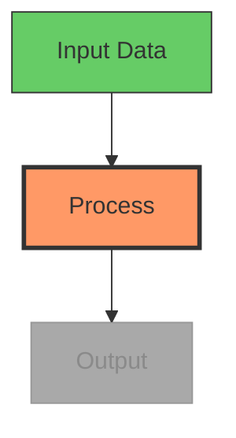

# OpenMontage 图表生成用法

> 来源：Mermaid.js 文档、`.agents/skills/beautiful-mermaid/` 现有 Layer 3 技能、
> Mermaid-Sonar 复杂度分析研究、Mermaid GitHub issues #651（缩放）、#3029（动画）

## 快速参考卡

```
MAX NODES (1080p):  15-20 nodes, 20-25 edges
MAX NODES (4K):     25-35 nodes, 35-45 edges
MAX NODES (vert):   10-12 nodes, 12-15 edges
MIN FONT SIZE:      16px at 1080p, 14px at 4K
RENDER WIDTH:       Minimum 1200px
RENDER VIEWPORT:    3840x2160 (4K) for high-res PNG export
THEME (dark bg):    tokyo-night or dracula
THEME (light bg):   github-light or catppuccin-latte
```

## 图表类型选择

| 类型 | 视频适用性 | 最适合 |
|------|------------------|----------|
| **流程图 (TD)** | 优秀 | 流程、决策树、算法 |
| **时序图** | 良好 | API 调用、用户交互、消息流 |
| **状态图** | 良好 | 状态机、生命周期、工作流状态 |
| **类图** | 一般 | 架构（限制在 3–5 个类） |
| **ER 图** | 不适合视频 | 过于密集 — 仅保留关键实体 |
| **甘特图** | 一般 | 时间线、项目阶段 |
| **思维导图** | 良好 | 概念概览、主题分解 |

**默认：** 除非内容明确需要其他类型，否则使用自上而下（`TD`）流程图。它们读起来自然，且适合逐步构建。

## 视频复杂度上限

视频是瞬态的 — 观众无法缩放或滚动。与静态文档相比，复杂度应减半。

| 目标分辨率 | 最大节点数 | 最大边数 | 最小字号 (CSS) |
|------------------|-----------|-----------|---------------------|
| 1920x1080 (HD) | 15-20 | 20-25 | 16px |
| 3840x2160 (4K) | 25-35 | 35-45 | 14px |
| 1080x1920 (竖屏) | 10-12 | 12-15 | 18px |

**若图表超出上述限制：** 拆成多帧，每帧只展示一部分。这也能为视频形成自然的「逐步构建」动画。

## 视频配色主题

| 使用场景 | 主题 | 原因 |
|----------|-------|-----|
| 深色视频背景 | `tokyo-night` 或 `dracula` | 高对比、易读 |
| 浅色视频背景 | `github-light` 或 `catppuccin-latte` | 柔和、专业 |
| 代码/开发者内容 | `one-dark` | 开发者受众熟悉 |
| 最大对比度 | `zinc-dark` | 中性、无色彩偏倚 |
| 企业/演示 | `nord-light` | 沉稳、专业 |

**与 playbook 一致：** 图表主题应配合风格 playbook 的调色板。

## 视频的渐进式构建

Mermaid 本身不支持动画。用渐进式渲染实现「逐步构建」效果：

### 方法：多阶段渲染

1. 分阶段渲染图表 — 先 2 个节点，再 4 个，再完整图
2. 每个阶段单独 Mermaid 渲染 → SVG → PNG
3. 在 FFmpeg 中对各阶段做交叉淡入或硬切
4. 让观众逐步跟上逻辑

### 高亮当前步骤

用 `classDef` 高亮当前节点、弱化已完成节点：



每步生成一张 PNG，使用不同的 `classDef` 分配，再在合成阶段按序拼接。

## 面向视频可读性的样式

### 节点尺寸
- 1080p 下最小节点宽度：150px
- 节点内边距：15–20px
- 每个节点文字控制在 3–5 个词 — 必要时用缩写

### 边标签
- 最多 1–2 个词
- 仅当关系从上下文不明显时才用边标签
- 优先用带标签的节点，而非带标签的边

### 布局方向
- **自上而下 (TD)：** 流程、层级、流向
- **自左向右 (LR)：** 时间线、序列、管道
- 避免自下而上 (BT) — 对多数观众不直观

## 在 OpenMontage 中的应用

使用 `diagram_gen` 工具时：

1. **检查复杂度** — 1080p 最多 15–20 个节点。更大图表拆成多帧
2. **选择主题** 以匹配视频的风格 playbook 与背景
3. **使用渐进式构建** — 渲染各阶段并在视频中交叉淡入以实现「构建」效果
4. **用 classDef 高亮** — 当前步骤用橙/红，已完成用绿，待处理用灰
5. **文字尽量精简** — 每节点 3–5 词，边标签 1–2 词
6. **默认流程图 TD** 除非内容明确需要其他图表类型
7. **以 4K 视口渲染**（3840x2160），即使输出为 1080p — 缩放后文字仍清晰
8. **测试可读性** — 合成前以实际视频帧尺寸查看渲染出的 PNG
